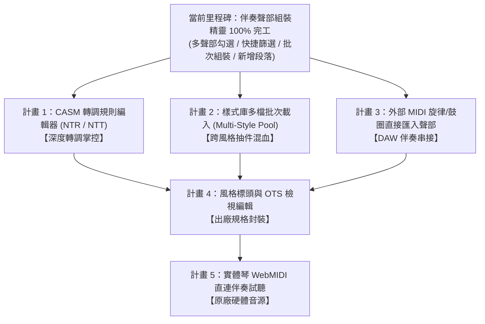

# 📋 Yamaha 伴奏與 Multi Pad 編輯器：後續待執行計畫清單 (Pending Execution Backlog)

> **建立時間**：2026-10-18  
> **當前系統狀態**：  
> - ✅ **Phase 1 & 2**：Yamaha Multi Pad 編輯、手彈即時錄音、步進輸入、音色嗅探、PSR-SX920 實體琴端對端驗收全數完成。  
> - ✅ **Phase 3 (Module 3)**：STY 伴奏工作台（雙視野時間軸、Track 0 鋼琴卷軸音符編輯、小節動態剪裁延伸、雷射紅走帶/琴鍵試聽、SFF2 CASM 完整保留與匯出防呆）全數完成。  
> - ✅ **Style Assembly Studio**：聲部開口矩陣 (Option A)、跨風格/跨段落聲部組裝 (Option B)、新增自訂/標準段落 (Add New Section)、多聲部自由勾選與批次組裝 (Multi-Part Selection & Batch Assembly) 全數完成。  
> - ✅ **測試狀態**：26 個測試套件、153 項單元測試 100% 通過，二進位 CASM 4,025 bytes 完好無損保留。

---

## 🎯 待執行計畫清單 (Upcoming Plans Backlog)

下列 5 項計畫已正式列入待執行庫，後續將依據製作優先順序與實際創作需求依序推進：

---

### 📌 計畫 1：CASM 和弦轉調規則視覺化檢視與微調 (CASM / NTR & NTT Editor)

* **目標**：  
  將 Yamaha SFF2 CASM 二進位區塊（`CASM` -> `Ctbl` -> `Cntt`）進行結構化解析與視覺化呈現，讓音樂製作人可檢視並微調各聲部在各段落的伴奏轉調行為。
* **核心功能**：
  1. **NTR (Note Transposition Rule)** 規則設定：
     - `Root Trans`（根音移調，適合 Melody / Bass / Phrase 旋律線）
     - `Root Fixed`（根音固定，適合吉他和弦刷弦、鋼琴分散和弦、弦樂鋪底）
  2. **NTT (Note Transposition Table)** 轉調表設定：
     - `Bypass`（直接原音，不隨和弦變音，打擊樂或固定特效用）
     - `Melody`（單音旋律智慧換音）
     - `Chord`（標準和弦自動展開與反轉音型）
     - `Bass`（低音音型專屬跟隨）
     - `Harmonic Minor` / `Melodic Minor`（小調專屬轉調表）
  3. **音域與破音限制防護**：
     - `High Key` / `Low Key` 限制，防止和弦轉調後音高衝破物理極限或低音混濁。
  4. **二進位寫回與驗證**：
     - 修改後的 CASM 區塊精確重新封裝為 Yamaha 原廠二進位格式，確實驗證與 PSR-SX900/SX920 / Genos 系列 100% 讀取相容。
* **優先度**：🔥 **首選推薦**

---

### 📌 計畫 2：樣式庫多檔批次載入與跨風格混搭抽件 (Multi-Style Library / Drag & Drop Pool)

* **目標**：  
  大幅擴充「來源風格 (Source Style)」樣式池，提供專屬的「樣式庫抽屜面板 (Style Library Drawer)」，實現跨風格快速抽件混搭。
* **核心功能**：
  1. **批次拖曳載入**：
     - 支援將電腦中的多個 `.sty` 伴奏檔（如 `70sDisco.sty`、`PopFunk.sty`、`Ballad8Beat.sty`）一次性拖入網頁樣式庫。
  2. **樣式庫概覽與快速試聽**：
     - 列表顯示每個風格的段落數、BPM、拍號與主奏聲部清單。
     - 支援單擊樣式即可在組裝精靈左側快速切換為來源風格。
  3. **跨風格混搭拼貼**：
     - 製作人可自由「抽取 A 風格的鼓組 + B 風格的 Bass + C 風格的木吉他刷弦」，一鍵批次拼貼至目標風格。
  4. **速度與拍號相容性智慧提示**：
     - 若來源風格速度或節拍（如 3/4 拍 vs 4/4 拍）差異過大，系統自動提示並提供時值縮放選項。
* **優先度**：🔥 **實用推薦**

---

### 📌 計畫 3：外部標準 MIDI 音軌直接匯入至指定段落聲部 (MIDI Loop / Clip to Style Part)

* **目標**：  
  打通外部現代 DAW（Logic Pro, Cubase, Ableton, FL Studio）與 Yamaha Style 之間的最後一哩路，允許將標準 `.mid` 音訊軌道片段直接注入伴奏風格。
* **核心功能**：
  1. **拖曳 MIDI 檔案/片段匯入**：
     - 使用者可直接將 4~8 小節的外部 MIDI 鼓圈或琶音旋律拖入組裝面板。
  2. **智慧通道與小節映射**：
     - 自動解析 MIDI 軌道音符，並提供下拉選單選擇欲填入的目標段落（如 `Main B`）與聲部（如 `Phrase 1`）。
  3. **時間軸與 PPQ 歸一化**：
     - 自動將外部 MIDI 的 Division（如 96, 192, 960）轉換對齊至 Yamaha 標準 480 PPQ，並裁切至目標段落小節長度。
  4. **自動控制器補全**：
     - 自動注入必要的 CC0 / CC32 / PC 音色事件與 CC7 (Volume)、CC10 (Pan) 預設值，確保檔案格式合法。
* **優先度**：⚡ **高擴充性**

---

### 📌 計畫 4：風格標頭中繼資料與 OTS (One Touch Setting) 檢視編輯 (Style Header & OTS Editor)

* **目標**：  
  完善 Yamaha 伴奏風格所有外部資訊與一鍵音色切換設定，達到原廠出廠級規格。
* **核心功能**：
  1. **風格標頭資訊編輯**：
     - 伴奏顯示名稱（Style Title）、音樂類別（Genre / Category）、作曲家與版權宣告（Copyright）。
     - 預設演奏速度（Default Tempo）、預設拍號（Time Signature）。
  2. **OTS (One Touch Setting 1~4) 檢視與調整**：
     - 檢視檔案內嵌的 4 組 OTS 音色配置（對應琴端面版 OTS 1、2、3、4 按鍵）。
     - 調整 OTS 關聯的右手主奏音色（Right 1 / Right 2）、音量比重與效果器設定。
* **優先度**：🎹 **完備度提升**

---

### 📌 計畫 5：WebMIDI 琴端直連與實體 SX900/920 伴奏即時監聽 (Hardware Direct Audition via WebMIDI)

* **目標**：  
  利用 WebMIDI API 連接 Yamaha PSR-SX900 / PSR-SX920 / Genos 實體琴，讓網頁上的所有伴奏試聽直接由琴端原廠頂級音源發聲。
* **核心功能**：
  1. **雙向 MIDI 串流切換**：
     - 試聽列新增「發聲來源：[ 瀏覽器軟體合成器 ▾ / 實體琴 PSR-SX920 ▾ ]」切換開關。
  2. **實體琴 16 軌同步直推**：
     - 試聽伴奏段落時，透過 WebMIDI 輸出即時傳送 Program Change、Bank Select 與 NoteOn/Off 事件至琴端。
     - 享受原廠 Super Articulation (S.Art) 音色與原廠 DSP 混響效果。
  3. **防掛音與全音重置保護**：
     - 停止播放時嚴格廣播 CC 123 (All Notes Off) 與 CC 120 (All Sound Off)，杜絕任何懸掛音符。
* **優先度**：🎧 **進階音質**

---

## 📈 規劃推進路徑

本清單已完整歸檔於專案根目錄，後續隨時可依據使用者指令優先啟動任一項目！
