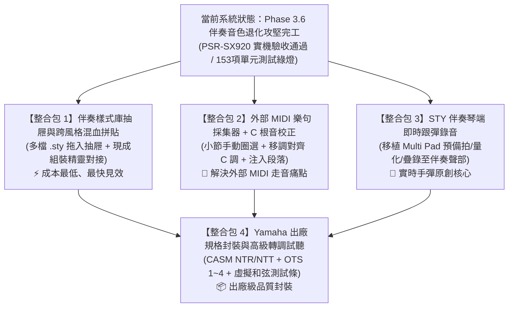

# 📋 Yamaha 伴奏與 Multi Pad 編輯器：後續待執行計畫清單 (Pending Execution Backlog)
# — 2026-10-19 全新收斂整合版 —

> **更新時間**：2026-10-19  
> **系統基石狀態**：  
> - ✅ **Phase 1 & 2**：Yamaha Multi Pad 編輯、手彈即時錄音 (Mode A)、步進和弦 (Mode B)、音色嗅探、PSR-SX920 實體琴端對端驗收全數完成。  
> - ✅ **Phase 3 (Module 3)**：STY 伴奏工作台（雙視野時間軸、Track 0 鋼琴卷軸音符編輯、小節動態剪裁延伸、雷射紅走帶/琴鍵試聽、SFF2 CASM 完整保留與匯出防呆）全數完成。  
> - ✅ **Style Assembly Studio**：聲部開口矩陣 (Option A)、跨段落/跨風格組裝 (Option B)、新增自訂/標準段落、多聲部自由勾選與批次組裝全數完成。  
> - ✅ **Phase 3.6 琴端音色退化 (Fallback to Piano) 重大問題攻堅完工**：修正 Bank LSB 0、隔離 SInt 第 1 小節、注入原廠 Style Header 與 XG On SysEx，已完成 PSR-SX920 實琴驗收。  
> - ✅ **測試狀態**：26 個測試套件、153 項單元測試 100% 通過。

---

## 🔍 前期推進中「已解決 / 核心已貫通」之項目查驗

在重新盤點需求前，以下項目在先前攻堅中已經有明確解法或實質完工，不需重複從零規劃：

1. **✅ 原議題 BACKLOG-01（Pad 3 等待進場之視覺走帶優化）— 【已解決歸檔】**：
   - **解法同調**：在 STY 伴奏工作台開發中確立了「以第 1 小節 (Tick 0) 為時間基準、前方如實繪製空白休止小節 (Resting Measures)」的標準專業 DAW 規範。
   - **同步至 PAD**：在 Commit `59d00ab` 中，已將此邏輯同步回 PAD 模式。走帶雷射線自第 1 小節掃過前導休止小節屬於正常音樂時序表現，畫布頂部亦已清楚標註「第 X 小節開始演奏」，視覺與聽覺認知完全一致。
2. **✅ 原計畫 5（WebMIDI 實體琴直連伴奏即時監聽）— 【核心發聲與路由已打通】**：
   - 主畫面已建立頂部發聲路由列（`💻 電腦` / `🎹 僅實體琴` / `雙出`）。
   - `AudioEngine.startBackingTrack` 於伴奏段落試聽時，已完整實作 MIDI Note-On/Off、Bank Select 與 Program Change 實時轉發，並經 Phase 3.6 注入 XG SysEx 保證琴端原廠音色正常發聲。
3. **✅ 原伴奏組裝核心（Style Assembly Studio）— 【基底已完工 80%】**：
   - 現有組裝精靈已具備跨段落聲部拼貼、小節循環自動填滿、移調、力度縮放、新增段落與多聲部批次複製。

---

## 🎯 重新收斂後的 4 大主題式整合執行包 (4 Major Integration Packages)

為避免需求過度零碎或方向衝突，將剩餘需求整合成 4 個高價值、可獨立落地的主題整合包：

---

### 📦 整合包一：【伴奏樣式庫抽屜與跨風格混血拼貼】 (Multi-Style Pool & Cross-Style Remixing)
* **對應原計畫**：原「計畫 2」之極致實踐，對接現有的 `Style Section Assembly Studio`。
* **核心目標**：
  突破目前組裝精靈左側只能讀取單一來源風格的限制，建立專屬「樣式庫抽屜面板 (Style Library Drawer)」，讓製作人可一次拖入 5~10 個 `.sty` 伴奏風格檔，實現跨風格自由抽件混血！
* **具體功能**：
  1. **樣式庫拖曳抽屜**：多檔拖曳暫存，列表顯示各風格名稱、段落數、BPM 與拍號。
  2. **跨風格聲部抽取**：組裝精靈左側來源選單可在多個載入風格間任意切換（如抽取 70sDisco 的鼓組 + FunkyGroove 的貝斯 + PopRock 的木吉他刷弦）。
  3. **速度與拍號智慧提示**：當來源風格速度或拍號（如 3/4 拍 vs 4/4 拍）與目標不同時，系統動態提示並提供時值縮放對齊選項。
  4. **無損批次組裝**：一鍵呼叫已完成的 `batchAssembleParts` 注入目標段落，CASM 與音色完全相容 Yamaha 琴端。
* **開發複雜度**：⚡ **低（核心組裝邏輯已現成，純前端樣式庫抽屜擴充）**
* **推薦指數**：⭐⭐⭐⭐⭐（最快見效、原廠音質 100% 完美）

---

### 📦 整合包二：【外部 MIDI 樂句採集器與 C 根音校正】 (MIDI Section Sampler & C-Root Normalizer)
* **對應原計畫**：原「計畫 3」+「方案 B」深度收斂，徹底取代不切實際的「整首 MIDI 全自動分段」。
* **核心目標**：
  打通外部 MIDI 歌曲與 Yamaha 伴奏之間的橋樑，由人耳精準採集 2~8 小節好聽的 Groove，並透過 C 根音校正徹底解決 Yamaha 琴端左手換和弦走音打架的宿命！
* **具體功能**：
  1. **時間軸小節精準採集 (Section Sampler)**：載入外部 MIDI 歌曲，播放預聽並以時間軸手動圈選精華小節區間（例如第 9~16 小節）。
  2. **關鍵核心：【C 根音校正 (C-Root Normalizer)】**：
     - 提供直觀和弦選單：`「此 4 小節原曲和弦基準為：[ G ▾ ]」`。
     - 系統自動在後台將選取音軌（除打擊樂外）向下平移 7 個半音（G 轉為 C 調），確保輸入 Yamaha 伴奏庫時符合標準 C 根音規範。
  3. **8 伴奏聲部智慧映射**：自動將鼓組對齊 Rhythm 1/2、低音對齊 Bass、吉他/鋼琴對齊 Chord 1/2。
  4. **指定段落注入**：一鍵將校正後的音符與 CASM 轉調區塊注入目標段落（如 Main A 或 Fill In）。
* **開發複雜度**：🛠️ **中（將原本複雜匯入彈窗簡化重構為小節採樣器 + 移調演算法）**
* **推薦指數**：⭐⭐⭐⭐⭐（解決外部 MIDI 走音破調的核心神器）

---

### 📦 整合包三：【STY 伴奏聲部琴端即時跟彈錄音】 (STY Live Metronome Overdub Recorder)
* **對應原計畫**：原「計畫 6」。
* **核心目標**：
  將 Multi Pad 成熟強大的手彈錄音工作站工作流，完整移植到 STY 伴奏工作台，讓鍵盤手可以在 PSR-SX920 琴上開著節拍器，直接為特定段落與聲部彈奏錄音！
* **具體功能**：
  1. **目標段落與聲部指定**：錄音彈窗可指定「目標段落（如 Main A）」與「目標聲部（如 Bass、Chord 1 或 Phrase 1）」。
  2. **模式 A 即時節拍器跟彈錄音**：
     - 4 拍預備拍木魚節拍器與視覺燈號。
     - 實時節拍器伴奏，彈奏完畢自動執行 1/16、1/8 智慧量化，保留實彈動態觸鍵力度。
  3. **多聲部疊錄伴奏監聽 (Multi-Part Overdub Backing)**：
     - 錄製 Bass 或吉他時，背景自動循環播放已有的鼓組或節奏骨架，彈奏對位更精準。
  4. **模式 B 彈窗單步步進和弦輸入**：手彈多鍵即時識別和弦名稱（`Cmaj7`、`Dm9` 等），支援休止符 (<kbd>Space</kbd>)、撤銷 (<kbd>Backspace</kbd>) 與延音 (<kbd>+</kbd>)。
* **開發複雜度**：🛠️ **中（復用 Multi Pad 錄音引擎至 STY 單軌）**
* **推薦指數**：⭐⭐⭐⭐（實時原創手彈演奏者必備）

---

### 📦 整合包四：【Yamaha 出廠規格封裝與高級轉調試聽】 (CASM, OTS & Virtual Chord Audition)
* **對應原計畫**：原「計畫 1」+「計畫 4」+「早期和弦測試條」。
* **核心目標**：
  在伴奏音符結構確立後，進行細緻的轉調邏輯掌控與原廠出廠規格封裝，達到原廠 Expansion Pack 級別的完備度。
* **具體功能**：
  1. **CASM 和弦轉調規則視覺化微調 (NTR / NTT Editor)**：
     - 各聲部獨立 NTR 設定（根音移調 Root Trans / 根音固定 Root Fixed）。
     - 各聲部獨立 NTT 設定（Bypass 原音直通、Melody 旋律、Chord 和弦反轉、Bass 低音專屬）。
     - High / Low Key 音域極限防護，防止轉調後音高破音。
  2. **風格標頭中繼資料與 OTS (One Touch Setting 1~4) 編輯器**：
     - 伴奏標題（Style Title）、樂風分類（Genre）、預設 Tempo、預設拍號與版權。
     - 檢視與調整琴端 4 組 OTS 按鍵關聯的右手主奏音色（Right 1 / Right 2）、音量與效果器。
  3. **虛擬左手和弦即時測試條 (Chord Audition Bar)**：
     - 畫面提供 `[C]`、`[Dm]`、`[Em]`、`[F]`、`[G7]`、`[Am]` 按鈕，循環播放時點擊可即時模擬 CASM 轉調發聲，在電腦端驗證換和弦聽感。
* **開發複雜度**：📦 **中高（需深入 CASM 樹狀二進位結構與 OTS 區塊封裝）**
* **推薦指數**：⭐⭐⭐⭐（高階編曲者出廠封裝必備）

---

### 📦 附屬擴充包：【鋼琴卷軸多音符批次進階工具】
* **對應原議題**：原 `BACKLOG-02` + `BACKLOG-03`。
* **核心目標**：
  擴充鋼琴卷軸批次檢查器（Batch Inspector）的實用編曲動作：
  1. **選取音符跨 Pad 搬移/複製 (Move/Copy to Pad X)**：將選取音符移到其他 Pad 創造雙樂器立體聲對位。
  2. **鼓組打擊樂器聲音批次替換 (Drum Note Remapping)**：Channel 10 鼓組軌道一鍵將所有小鼓/邊擊鼓替換為其他打擊樂器音高。
* **開發複雜度**：⚡ **低（純批次資料平移與音高對應）**

---

## 📈 整合包推進依賴地圖

本清單即日起作為全專案後續功能開發之正式基準依據。
