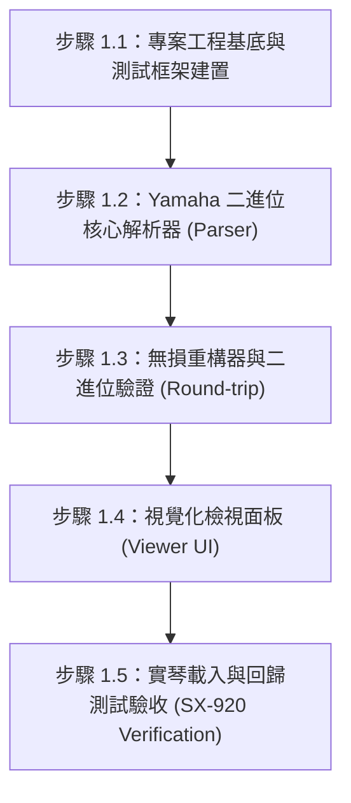

# 階段 1：基礎解析與透視引擎執行計畫書 (PHASE 1 IMPLEMENTATION PLAN)

## 1. 階段目標
本階段旨在建立 STY 與 PAD 檔案的底層二進位處理核心與輕量視覺化檢視介面。
核心目標為**「透視檔案內部細節」**與**「無失真二進位重構（Round-trip）」**，確保任何檔案讀入並寫出後，皆能通過 PSR-SX920 實琴載入驗證，不遺失 Yamaha 專屬資料區塊（CASM / OTS）。

---

## 2. 細部執行步驟 (Work Breakdown Structure)

### 步驟 1.1：專案工程基底與測試框架建置
* **工作項目**：
  1. 初始化 Node.js + TypeScript 專案。
  2. 配置 Vite 構建工具與 Vitest 單元測試框架。
  3. 規劃模組目錄結構（`core/parser`, `core/writer`, `ui`, `tests`）。
* **驗收標準**：
  - 專案能順利執行 `npm test` 與 `npm run dev`。

### 步驟 1.2：Yamaha 二進位核心解析器 (Parser)
* **工作項目**：
  1. **標準 MIDI 區塊解析**：解析 `MThd`（頭部、Track 數量、Division）與 `MTrk`（MIDI 音軌事件、Tempo、Time Signature）。
  2. **Yamaha 段落 Marker 識別**：精準讀取 Section 標記（如 `Main A`、`Main B`、`Intro A`、`Fill In AA`、`Ending A`）。
  3. **Yamaha 專屬區塊識別與定位**：
     - `CASM`（Chord Accompaniment Style Maker - 和弦轉換規則）。
     - `CSEG`、`SDEC` 等 CASM 子區塊。
     - `OTS`（One Touch Setting - 面板音色預設值）。
     - `MH` / 其他元數據標籤。
  4. 產出結構化 JavaScript/TypeScript 資料物件（AST / Data Model）。
* **驗收標準**：
  - 給定樣品 `.sty` 或 `.pad` 檔案，能無錯誤印出結構化 JSON，包含段落、聲部與專屬區塊偏移量。

### 步驟 1.3：無損重構器與二進位驗證 (Round-trip Packager)
* **工作項目**：
  1. 實作二進位寫入器（Writer）：將解析出的記憶體物件轉換回標準二進位檔案。
  2. 自動化 Byte-level 比對腳本：
     - `原始檔案` ➔ `解析` ➔ `寫出新檔案` ➔ 比對差異。
  3. 確保專屬區塊的長度與校驗碼完全相容。
* **驗收標準**：
  - 重構輸出的檔案結構、區塊順序與內容完整無失真。
  - 單元測試通過率 100%。

### 步驟 1.4：視覺化檢視面板 (Viewer UI)
* **工作項目**：
  1. 打造輕量、現代化的網頁檢視介面。
  2. **檔案拖曳載入區**：支援直接將 `.sty` 或 `.pad` 拖入瀏覽器。
  3. **基本資訊卡片**：顯示節奏名稱、BPM、拍號、總長度。
  4. **段落總覽 (Section Grid)**：直觀展示包含的段落（Intro 1~3, Main A~D, Fill-in, Ending 等）及各自小節數。
  5. **聲部配置清單 (Part/Track List)**：清楚顯示 8 個伴奏聲部（Rhythm 1-2, Bass, Chord 1-2, Pad, Phrase 1-2）所使用的音色名稱或 MSB/LSB/PC、預設音量與聲相。
  6. **專屬區塊狀態指示燈**：標示 CASM / OTS 區塊狀態。
* **驗收標準**：
  - 使用者在瀏覽器中開啟頁面，拖入檔案後能在 1 秒內清晰瀏覽所有內部資訊。

### 步驟 1.5：實琴載入與回歸測試驗收 (SX-920 Verification)
* **工作項目**：
  1. 將重構後的測試檔案拷貝至 USB 隨身碟。
  2. 在 Yamaha PSR-SX920 實體琴上進行測試：
     - 測試一：能否正常載入（不跳出 "Data Error"）。
     - 測試二：按面板段落鍵（Main A/B、Fill-in）能否正常播放。
     - 測試三：彈奏左手和弦能否正確轉調（CASM 正常生效）。
* **驗收標準**：
  - 實體琴 100% 正常播放與換和弦，並記錄測試日誌。

---

## 3. 防回歸措施 (Regression Prevention)
1. **快照測試 (Snapshot Testing)**：保留真實樣品解析後的 JSON 快照，日後調整程式碼若非預期更動會立即報警。
2. **二進位完整性校驗測試**：每次 commit / 程式變更時自動執行 Round-trip 測試。

---

## 4. 階段執行進度追蹤表記錄
| 子項目 | 狀態 | 負責人 | 驗證結果 | 備註 |
| :--- | :--- | :--- | :--- | :--- |
| 1.1 專案基底建置 | **已完成** | AI & User | **通過** (Vitest 測試通過 100%) | TypeScript, Vite, Vitest 環境就緒 |
| 1.2 核心解析器 (Parser) | **已完成** | AI | **通過** (真實 STY/PAD 檔案驗證 100%) | 成功解析 SFF2 段落、各聲部音色與 CASM 區塊 |
| 1.3 無損重構器 (Round-trip) | **已完成** | AI | **通過** (Byte-to-byte 比對 100% 一致) | 重構後 STY/PAD 零位元組差異，CASM 完全保真 |
| 1.4 視覺化檢視面板 (UI) | **已完成** | AI & User | **通過** (Web 介面已上線，支援拖曳解析) | 提供段落積木、8 軌混音、CASM 狀態與一鍵重構導出 |
| 1.4+ Pad 音符透視與迷你卷軸 | **已完成** | AI & User | **通過** (點擊 Pad 即時渲染音符/音域/Mini Roll) | 解決 Pad 4 缺漏問題、控制標籤雜訊分離、軌道 1~4 精準綁定 Pad 1~4 |
| 1.5 SX-920 實琴驗收 | **已完成** | User | **通過** (實體琴載入播放 100% 正常) | 使用者實機於 Yamaha PSR-SX920 驗證通過，檔案正常載入演奏，二進位相容性確認無誤 |
