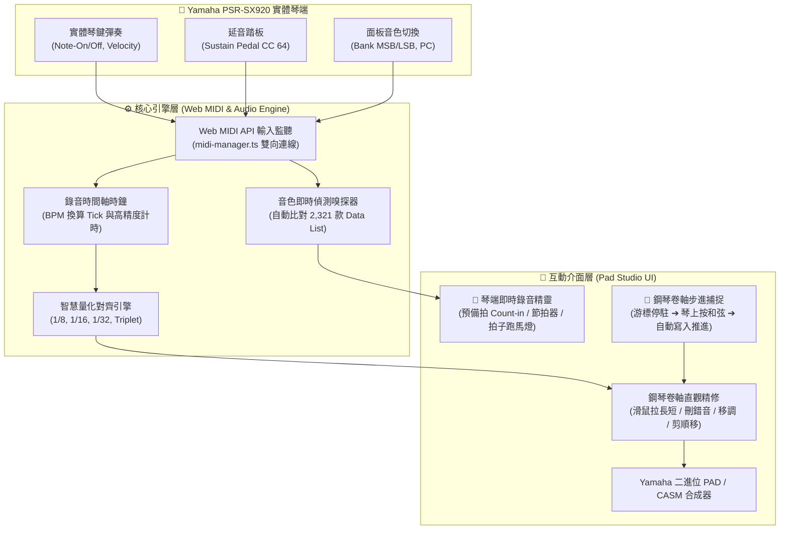

# Yamaha PSR-SX920 實體琴即時彈奏錄音與音色擷取系統計畫書 (Phase 2.7)

本計畫旨在打通 **「PSR-SX920 實體琴即時彈奏 ➔ 電腦端高精度音符與音色捕獲 ➔ 鋼琴卷軸直觀微調 ➔ 一鍵生成 Yamaha PAD/CASM」** 的現代化創作閉環。

---

## 🎯 核心願景與解決痛點

* **傳統痛點**：
  * 在琴端內建的 Multi Pad Creator 錄音，若彈錯一個音或節奏稍有誤差，在小觸控螢幕上修改 Event List 極為痛苦繁瑣。
  * 在純電腦軟體用滑鼠點音符，缺乏實體鍵盤的演奏手感、力度動態（Velocity）與原廠立體聲音色反饋。
* **全新閉環**：
  * **手感在琴端**：坐在舒服的琴前彈奏，享受 PSR-SX920 原廠鍵床與震撼音響。
  * **編輯在大螢幕**：電腦端自動同步捕獲音符、小節、力度與音色，透過大螢幕鋼琴卷軸、力度直方圖、一鍵量化與小節順移快速剪修，輕鬆產出 100% 合規的 Multi Pad 檔案！

---

## 🏗️ 系統架構圖 (Architecture Overview)

---

## 📋 五大實施模組與開發工作細部拆解

### 模組 1：Web MIDI 雙向輸入監聽與音色嗅探器 (MIDI In & Voice Sniffer)
* **核心檔案**：`src/core/audio/midi-manager.ts`
* **工作內容**：
  1. **輸入埠啟用**：在既有的 `requestMIDIAccess` 基礎上，同時開啟 `MIDIAccess.inputs`，自動綁定 Yamaha PSR-SX920 的 MIDI 輸入埠。
  2. **事件解析分流**：
     - `Note-On (0x90)` / `Note-Off (0x80)`：精確提取音高（Pitch 0~127）、觸鍵力度（Velocity 1~127）。
     - `Control Change (0xB0)`：延音踏板（CC 64）、表情（CC 11）、顫音（CC 1）。
     - `Program Change (0xC0)` 與 `Bank Select (CC 0 / CC 32)`。
  3. **音色即時嗅探 (Voice Sniffer)**：
     - 當使用者在琴端轉動輪盤或按下音色按鍵切換音色時，軟體即時收到 Bank/PC。
     - 自動呼叫 `findYamahaVoice(msb, lsb, pc)`，在畫面顯示當前琴端音色（如 `CFX Concert Grand` 或 `Vintage EP`），並自動更新該 Pad 的原廠身份證與圖標代碼！
  4. **訊號閃爍燈**：在網頁頂部硬體狀態列加入 `[● MIDI IN]` 訊號指示燈，琴鍵一按即時綠光閃爍，連線狀態一目了然。

---

### 模組 2：高精度錄音時間軸與預備拍節拍器 (Recording Clock & Metronome)
* **核心檔案**：`src/core/audio/audio-engine.ts`, `src/core/writer/pad-recorder.ts`
* **工作內容**：
  1. **Web Audio 原生節拍器**：
     - 4 拍預備拍（Count-in: 1 - 2 - 3 - 4，第一拍高音木魚，第 2~4 拍低音木魚）。
     - 錄音期間伴隨節拍 Click 聲，音量可調整或靜音。
  2. **毫秒至 MIDI Tick 換算系統**：
     - 以標準 PPQ（預設 480，或跟隨目前檔案 96）精確對齊。
     - 根據目前設定的 BPM 速度，將物理時間戳記（`performance.now()`）無縫轉換為相對 Tick。
  3. **小節自動邊界控制**：
     - 設定錄製 1、2 或 4 小節；到達最後一小節結束拍時自動定格收尾，確保頭尾時間長度完全符合 Yamaha 小節規範。

---

### 模組 3：智慧量化吸附引擎 (Smart Quantization Engine)
* **核心檔案**：`src/core/writer/pad-recorder.ts`
* **工作內容**：
  1. **多精度網格吸附**：
     - 提供精度選項：`關閉 (Off - 保留手感微時差)`、`1/4 (四分音符)`、`1/8 (八分音符)`、`1/16 (十六分音符)`、`1/32`、`三連音 (Triplets)`。
  2. **音符起點與長度平滑修復**：
     - 起始拍吸附至最近的網格點（防止搶拍或拖拍）。
     - 自動防止音符重疊或負時差，確保每個 Note-On 都有合規的 Note-Off。

---

### 模組 4：鋼琴卷軸「步進手彈捕捉」模式 (Step Input Mode)
* **核心檔案**：`src/ui/app.ts`, `src/ui/piano-roll.ts`
* **工作內容**：
  1. **步進工作流**：
     - 在鋼琴卷軸工具列開啟 `[🎹 步進手彈模式]`。
     - 選擇步進拍位（例如以 1 拍或半拍為單位）。
     - 滑鼠游標停在目標小節拍位。
  2. **和弦/單音即時灌入**：
     - 雙手在實體琴鍵上按下一個和弦（例如 C-E-G），軟體即時在該拍位同時「印上」這 3 顆音符。
     - 琴鍵放開後，走帶游標自動前進到下一拍，等待下一個音符輸入。
     - 介面提供 `[休止符]` 按鈕（或按鍵盤 Space 鍵跳過當前拍）。

---

### 模組 5：直觀錄音精靈彈窗 (UI & Live Recording Wizard)
* **核心檔案**：`index.html`, `src/ui/app.ts`, `src/ui/style.css`
* **工作內容**：
  1. 在各 Pad 卡片與工具列加入 **[🔴 琴端錄音]** 按鈕。
  2. 彈窗設定面板：
     - **目標 Pad**：Pad 1 ~ 4 快捷切換。
     - **錄製品質**：預備拍（4 拍開關）、速度 BPM、錄音小節長度（1, 2, 4, 8 小節）。
     - **量化設定**：即時量化開關與精度選單。
     - **琴端當前音色預覽**：即時顯示目前琴鍵打出來的音色名稱與三聯號。
  3. **動態錄音視覺指示器**：
     - 拍子指示器（1 - 2 - 3 - 4 動態跳動燈號）。
     - 小節進度條（Progress Bar）。
  4. **錄完立即接軌**：
     - 錄完後自動關閉彈窗，鋼琴卷軸立即呈現剛剛彈奏的彩色音符條與力度柱。
     - 隨時可以按 `[▶ 試聽]`，琴端喇叭立即回放剛剛錄好的 Pad！

---

## 🗓️ 實施進度階段規劃 (Milestones)

| 階段 | 任務內容 | 產出與驗收標準 |
| :--- | :--- | :--- |
| **Step 1** | Web MIDI 雙向輸入監聽與音色即時偵測 | `midi-manager.ts` 收到實體琴 Note-On/Off 與 Bank/PC，頂部綠燈閃爍。 |
| **Step 2** | 錄音計時核心、Web Audio 預備拍節拍器與時間換算 | `pad-recorder.ts`，能準確將毫秒轉為 PPQ Tick，小節收尾合規。 |
| **Step 3** | 智慧量化對齊演算法實作與單元測試 | 5 種網格吸附測試通過，手彈誤差自動貼齊網格。 |
| **Step 4** | 琴端錄音精靈 UI 彈窗與動態拍子走帶燈 | `index.html` 彈窗整合，支援預備拍、小節設定與即時音色預覽。 |
| **Step 5** | 鋼琴卷軸「步進手彈捕捉模式」整合 | 鋼琴卷軸可直接依實體琴鍵按下自動填入和弦並自動步進。 |
| **Step 6** | 端對端實體琴錄製驗收與 PAD 二進位匯出 | 在 SX920 實體琴彈奏 2 小節，匯出 `.PAD` 插回琴端無縫循環播放。 |

---

## ❓ 關鍵設計確認（請使用者指導與確認）

1. **優先順序選擇**：
   - 您傾向**先做「模式 A：節拍器即時錄音（適合彈奏整段節奏/琶音）」**，還是**先做「模式 B：步進輸入（適合慢慢彈柱式和弦）」**？或者兩者一併規劃實作？
2. **預備拍習慣**：
   - 預備拍預設為 **1 小節（4 拍）** 是否符合您的彈奏習慣？
3. **量化預設值**：
   - 錄音後的量化對齊，您希望**預設開啟（如 1/16 拍自動吸附整齊）**，還是**預設關閉（保留純手彈原始微律動，手動點選再量化）**？
