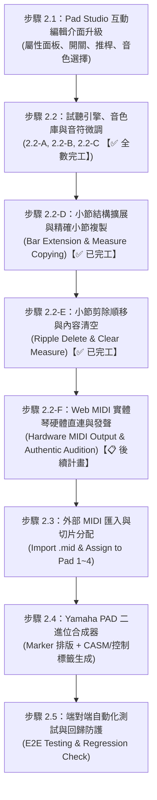

# 階段 2：Multi Pad 編輯模組執行計畫書 (PHASE 2 IMPLEMENTATION PLAN)

## 1. 階段願景與目標
在「階段 1」中，我們已經成功打通了 Yamaha PSR-SX 系列檔案的底層結構透視、精準過濾專利控制標籤（RP, CM, N, I），並驗證了二進位層級的 100% 無失真重構能力。

**「階段 2」的核心目標是：打造一個直觀、可即時試聽、可編輯與可創作的【Multi Pad 專屬工作台 (Pad Studio)】。**
讓使用者不需要在琴上的小螢幕翻找深層選單，即可在電腦端輕鬆完成：
1. **Pad 屬性修改**：名稱、圖示、循環模式 (Repeat)、和弦跟隨 (Chord Match)、音色、音量與聲相。
2. **電腦端即時試聽**：點擊打擊墊即可直接聽見旋律與節奏，無需每次插隨身碟到琴上。
3. **外部 MIDI 匯入製作**：將一般 DAW 或網路下載的 `.mid` 音樂片段，一鍵切片並指派為 Pad 1~4。
4. **Yamaha 標準二進位合成**：全新生成符合 PSR-SX920 規格的 `.pad` 檔案（包含 CASM 和弦跟隨區塊與控制標籤）。

---

## 2. 細部工作分解 (Work Breakdown Structure)

### 步驟 2.1：Pad Studio 互動編輯介面升級 (Pad Studio UI & Editing Controls) 【✅ 100% 完成】
* **工作項目**：
  1. 將目前的唯讀 Viewer 升級為「可編輯狀態 (Editor Mode)」。
  2. **4 顆實體卡片擴充編輯項**：
     - **Pad 名稱輸入**：直接修改顯示名稱（即時寫入底層 `N1~N4` 控制標記）。
     - **循環播放開關 (Repeat / RP)**：圖形化 Toggle 開關，切換單次播放或無限循環。
     - **和弦跟隨開關 (Chord Match / CM)**：圖形化 Toggle 開關，切換固定音高（打擊/音效）或隨左手和弦轉調。
     - **樂器音色與琴端圖標選擇 (Icon & Voice Selector / I1~I4)**：提供鋼琴、弦樂、吉他、貝斯、薩克斯風、銅管、合成器、鼓組等 Yamaha 常用音色清單，全面雙向連動琴端圖標代碼（如 `S801`, `S809`, `S815` 等）與 MIDI 音軌的 Bank MSB、Bank LSB、Program Change。
  3. **各 Pad 混音推桿與音色調整 (Parts Mixing Table)**：
     - 各聲部即時音量滑桿（Volume 0~127）、左右立體平衡（Pan L64~C~R63）、混響深度（Reverb 0~127）。
     - 混音表格中的 Bank MSB、Bank LSB、PC 輸入框與上方 Pad 卡片樂器下拉選單完全雙向連動。
  4. **獨立音軌音符卷軸 (Note Roll)**：
     - 解決 Multi Pad 軌道獨立音符提取問題，精確計算小節數與音域範圍，並在詳細摘要中高亮標示當前指派的「演奏音色」。
* **驗收標準**：
  - 調整介面數值後，記憶體中的 Pad 資料模型與音軌事件即時同步更新，可隨時匯出修改後的二進位檔案。
  - 單元測試與專案編譯 100% 通過。

### 步驟 2.2：瀏覽器內即時試聽引擎與實時音符微調 (Audio Engine & Piano Roll Real-time Note Editing) 【✅ 100% 完成】
* **工作項目**：
  1. **步驟 2.2-A：Web Audio 瀏覽器即時試聽引擎與走帶游標**：
     - 建立輕量 Web Audio API 聲音引擎，提供鋼琴、弦樂、吉他、貝斯、薩克斯、鼓組等物理諧波多樂器合成。
     - 每顆 Pad 卡片新增 **[▶ 試聽] / [■ 停止]** 按鈕。
     - 點擊試聽時，鋼琴卷軸與迷你音符卷軸同步顯示精準走帶雷射指針，音符撞擊時觸發金色亮光。
     - 支援 BPM 速度手動調節、即時響應。
  2. **步驟 2.2-B：Yamaha PSR-SX920 原廠音色庫與搜尋面板**：
     - 內建 Yamaha 官方分類音色資料庫（包含 Piano, Strings, Guitar, Bass, Brass, Synth 等數十種熱門音色）。
     - 即時彈窗搜尋面板，支援關鍵字即時過濾、樂器試聽發聲。
     - 一鍵套用音色，自動連動寫入 Bank MSB (CC0)、Bank LSB (CC32)、Program Change (PC) 與琴端圖標代碼（如 `S809`）。
  3. **步驟 2.2-C：鋼琴卷軸實時音符微調（模組一 ~ 四）**：
     - **模組一 (選取與檢查器)**：點擊音符高亮選取，浮動屬性檢查器（Bar.Beat.16th.Tick、音高音名、長度、力度）、單鍵發聲試聽。
     - **模組二 (音長與位置拖曳)**：音符右端邊緣拖拉縮放音長（支援 1/32 網格吸附與 Shift 1-Tick 微調）；音符本體抓取平移（8px 防誤觸閾值、自動吸附網格）。
     - **模組三 (DAW 力度軌道)**：音符下方對齊 1~127 垂直直方柱，頂部支援 `ns-resize` 垂直拖曳調力度，上下雙向高亮連動。
     - **方案 A (音高上下移調與快捷鍵)**：檢查器提供 `[-8度]`、`[▼]`、`[▲]`、`[+8度]` 按鈕，鍵盤 <kbd>↑</kbd>/<kbd>↓</kbd> 半音、<kbd>Shift</kbd>+<kbd>↑</kbd>/<kbd>↓</kbd> 八度、<kbd>←</kbd>/<kbd>→</kbd> 平移、<kbd>Esc</kbd> 取消選取。
     - **模組四 (音符刪除與三向新增)**：檢查器 `[🗑️ 刪除]` 按鈕與鍵盤 <kbd>Delete</kbd>/<kbd>Backspace</kbd> 刪除；支援 `[➕ 新增音符]` 按鈕、`[✏️ 畫筆模式]` 單擊新增、以及容差軟體雙擊新增。
     - **二進位安全無損同步**：所有編輯底層重算 Delta-Time，嚴格維護 Note-On / Note-Off 配對與 `0x2F` End-of-Track，確保後續音符時間軸零偏移。
* **驗收標準**：
  - 點擊任一 Pad 的播放鈕，電腦喇叭能清晰播放該 Pad 的音符節奏與旋律。
  - 實時調整音符位置、長度、音高、力度、增刪音符後，二進位重構與單元測試 100% 通過，使用者實測體驗流暢無誤。

### 步驟 2.2-D：小節結構動態擴展與精確小節複製 (Bar Extension & Measure Copying) 【✅ 100% 完成】
* **工作項目**：
  1. **小節長度動態調整與擴展 (Bar Length Stepper & Extension)**：
     - 在工具列配置 `Pad 長度：[-] [ 4 小節 ] [+]` 控制項。
     - 點擊 `[+]` 即可在結尾追加空白小節，畫布尺規與導航按鈕自適應延伸。
     - 底層安全機制：自動重算並往後推移結尾標記（End of Track `0x2F`），使 PSR-SX920 琴端識別擴展後的完整循環長度。
  2. **精確小節複製與傳送 (Measure Copying & Duplication)**：
     - **方案 A（小節傳送選單）**：提供 `[📋 複製小節] 來源: [第 1 小節 ▼] ➔ 目標: [第 3 / 5 小節 ▼] [執行複製]`，跳小節複製不干擾中間內容，目標超出當前長度時自動擴展總小節數。
     - **方案 B（尺規選取複製貼上）**：點選上方時間軸尺規小節頭高亮全小節音符，支援鍵盤 <kbd>Ctrl</kbd> + <kbd>C</kbd> / <kbd>Ctrl</kbd> + <kbd>V</kbd>。
     - **方案 C（快速倍增）**：支援鍵盤 <kbd>Ctrl</kbd> + <kbd>D</kbd> 一鍵將當前小節倍增接續於後方。
* **驗收標準**：
  - 能夠將 4 小節 Pad 擴展為 5 或 6 小節，並在第 5、6 小節新增音符或複製貼上。
  - 將第 1 小節音符精準複製至第 3 或第 5 小節，拍點與音高 100% 正確，單元測試通過率 100% (28/28)。

### 步驟 2.2-E：小節剪除順移與內容清空 (Ripple Delete & Clear Measure) 【✅ 100% 完成】
* **工作項目**：
  1. **模式 A：小節剪除順移 (Ripple Delete / 刪除小節結構)**：
     - 使用者指定刪除任一小節（如第 2 小節）。
     - 系統全自動清理目標小節內的所有音符（無須手動預先清空）。
     - 後方小節音符自動往前平移 1 個小節的 Ticks（第 3、4 小節前移為第 2、3 小節）。
     - Pad 總長度自動縮減 1 個小節，同步更新 End-of-Track (`0x2F`) 與 Section 標記。
  2. **模式 B：小節音符清空 (Clear Measure / 僅清空音符)**：
     - 保留小節結構與總長度，全自動清空該小節內的所有音符為靜音空白。
     - 後方小節音符位置與 Pad 總長度保持不變。
  3. **互動操作介面**：
     - 尺規高亮 + 快捷鍵：點選小節後按 <kbd>Shift</kbd> + <kbd>Delete</kbd> 觸發模式 A（剪除順移）；按 <kbd>Delete</kbd>（未選單音時）觸發模式 B（清空音符）。
     - 工具列操作：配置 `[第 X 小節 ▼] [✂️ 剪除小節] [🧹 清空音符]` 按鈕組。
* **驗收標準**：
  - 無需手動清空音符即可直接刪除任意小節，後方音符時序與拍點完美遞補無偏移。
  - 二進位 Delta-Time 重算與單元測試 100% 通過。

### 步驟 2.2-F：Web MIDI 實體琴硬體直連與發聲 (Hardware MIDI Output & Authentic Audition) 【📋 列入後續計畫】
* **工作項目**：
  1. **實體琴輸出埠自動偵測**：
     - 頂部控制列配置 `[🎹 實體琴直連: 關閉 ▼]` 設備選單與狀態燈。
     - 透過 `navigator.requestMIDIAccess()` 自動偵測插上電腦的 Yamaha 設備（如 `Digital Workstation`、`Yamaha USB-MIDI` 等）。
  2. **發聲路由雙向切換**：
     - 支援切換「電腦喇叭 (Web Audio 內建合成)」與「實體琴輸出 (Web MIDI 直連)」或雙軌並行。
  3. **琴端原廠音色自動同步 (Bank & Program Change)**：
     - 播放 Pad 或點選音符試聽時，自動向琴端對應通道發送 Bank Select (CC0 MSB / CC32 LSB) 與 Program Change (PC)，使 PSR-SX920 自動切換至指定原廠樂器音色發聲。
  4. **即時混音與防掛音保護**：
     - 同步傳送 CC7 (音量) 與 CC10 (聲相)，停止播放時廣播 `CC 123 (All Notes Off)` 防殘音。
* **驗收標準**：
  - 電腦透過 USB-to-Host 線連接 PSR-SX920 後，選取琴端連接埠，點選試聽能直接由實體琴以原廠頂級音源與音色發聲。

### 步驟 2.3：外部標準 MIDI 匯入與切片分配 (MIDI Import & Slicing)
* **工作項目**：
  1. 提供「匯入外部 MIDI」功能，支援拖入任意標準 `.mid` 檔案。
  2. 解析匯入的 MIDI 檔案軌道與小節長度。
  3. **分配精靈 (Assignment Wizard)**：
     - 讓使用者選擇將檔案的哪個小節、哪條音軌指定給哪一顆 Pad（Pad 1, 2, 3 或 4）。
     - 自動計算並補齊小節邊界與 Ticks 基準對齊（Quantize & Align）。
* **驗收標準**：
  - 能夠將任意 1~4 小節的外部 MIDI 旋律成功裝載進 Pad 1~4 中並預覽。

### 步驟 2.4：Yamaha PAD 專屬二進位合成器與 CASM 注入 (Pad Generator & CASM Synthesizer)
* **工作項目**：
  1. 打造全新的二進位合成模組 `YamahaPadGenerator`（不同於 1.3 的原樣重構，此模組能從零組裝全新檔案）：
     - **MIDI 時間軸自動排版**：將 4 個 Pad 的音符事件依序串接在 MIDI 時間軸上，並寫入標準 Section Markers（`Main A`、`Fill B`、`Main B`、`Fill C`）。
     - **控制標籤自動編碼**：將編輯好的設定編碼為結尾標記（`RPxxxx`、`CMxxxx`、`N1~N4`、`I1~I4`）。
     - **CASM 和弦區塊生成**：針對開啟「和弦跟隨 (Chord Match)」的聲部，自動生成 Yamaha 標準 CASM 區塊（設定 NTR/NTT 規則，如 Root Transpose / Chord 轉調規則）。
  2. 匯出標準 `.pad` 檔案。
* **驗收標準**：
  - 生成的二進位檔案能被既有的 `YamahaParser` 完美讀回，且屬性與音符 100% 吻合。

### 步驟 2.5：端對端自動化測試與回歸防護 (E2E Tests & Regression Check)
* **工作項目**：
  1. 撰寫自動化端對端測試：
     - `外部 MIDI ➔ 切片 ➔ 設定屬性 ➔ 生成 PAD 檔案 ➔ 讀回解析 ➔ 驗證資料一致`。
  2. **全面回歸測試 (Non-Regression Testing)**：
     - 確保階段 1 的 STY 解析器、無損重構器（Round-trip）的 9 項測試維持 100% 通過。
  3. 產出實體琴測試檔案至 `usb_test_export/`。
* **驗收標準**：
  - 全套自動化單元測試 100% 通過，無任何回歸問題。

---

## 3. 防回歸與品質原則 (Quality & Non-Regression Policy)
1. **解耦設計**：Phase 2 的新功能（生成器、編輯介面、聲音引擎）以獨立模組撰寫，不破壞 Phase 1 既有的基礎 Parser 與 Writer。
2. **全量測試防護**：每個步驟變更後，均必須執行 `npm test` 確保既有 9 項測試持續通過。
3. **實琴相容性優先**：合成出的 PAD 檔二進位規格必須完全符合 Yamaha PSR-SX920 格式標準。

---

## 4. 階段 2 執行進度追蹤表記錄
| 子項目 | 狀態 | 負責人 | 驗證結果 | 備註 |
| :--- | :--- | :--- | :--- | :--- |
| 2.1 Pad Studio 互動編輯介面 | **已完成** | AI & User | **通過** (單元測試 + UI 雙向綁定驗證 100%) | 支援 Pad 名稱、CM、RP、圖示、音量推桿、Pan、混響與音色即時修改與二進位同步匯出 |
| 2.2-A 瀏覽器內即時試聽引擎 | **已完成** | AI & User | **通過** (Web Audio 多樂器合成 + 走帶游標 + 單元測試 100%) | 支援 Pad 卡片一鍵試聽、即時走帶雷射指針、發光音符、BPM 速度切換與 Web MIDI 直連支援 |
| 2.2-B Yamaha SX920 原廠音色庫 | **已完成** | AI & User | **通過** (官方音色分類庫 + 搜尋彈窗 + 一鍵帶入 100%) | 整合 Yamaha 官方音色分類、關鍵字過濾搜尋彈窗、三聯號與琴端圖標代碼全自動映射 |
| 2.2-C 鋼琴卷軸實時音符微調 | **已完成** | AI & User | **通過** (模組一~四 + 方案A + 實測驗收 100%) | 支援檢查器、音長縮放、位置平移、力度軌道、音高移調按鈕與快捷鍵、刪除與三向新增音符 |
| 2.2-D 小節結構擴展與複製 | **已完成** | AI & User | **通過** (小節擴展步進器 + 1➔3/5 跳小節複製 + 尺規點選 + Ctrl+D + 單元測試 100%) | 支援 Pad 長度步進器 (追加 1~2 小節)、精準小節傳送選單 (1 ➔ 3/5)、尺規點選複製貼上與 Ctrl+D 倍增 |
| 2.2-E 小節剪除順移與內容清空 | **已完成** | AI & User | **通過** (模式A Ripple Delete + 模式B Clear Measure + 快捷鍵 + 單元測試 100%) | 支援模式A (Ripple Delete 剪除順移後方音符)、模式B (Clear Measure 僅清空音符)、快捷鍵 (Shift+Del / Del) 與工具列按鈕 |
| 2.2-F Web MIDI 實體琴直連發聲 | 後續計畫 | AI & User | - | 支援 Web MIDI 輸出埠自動偵測、實體琴原廠音色切換 (Bank/PC)、CC7/CC10 同步與 All Notes Off 防掛音 |
| 2.3 外部 MIDI 匯入與切片分配 | 待開始 | AI | - | 支援外部 .mid 匯入並指派至 Pad 1~4 |
| 2.4 Yamaha PAD 二進位合成器 | 待開始 | AI | - | 自動排版時間軸、生成控制標籤與 CASM |
| 2.5 端對端測試與回歸防護 | 待開始 | AI & User | - | 全套測試 100% 通過與實機驗收準備 |
