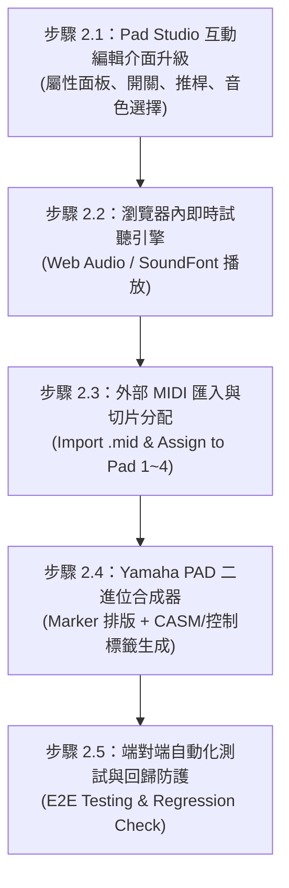

# 階段 2：Multi Pad 編輯模組執行計畫書 (PHASE 2 IMPLEMENTATION PLAN)

## 1. 階段願景與目標
在「階段 1」中，我們已經成功打通了 Yamaha PSR-SX 系列檔案的底層結構透視、精準過濾專利控制標籤（RP, CM, N, I），並驗證了二進位層級的 100% 無失真重構能力。

**「階段 2」的核心目標是：打造一個直觀、可即時試聽、可編輯與可創作的【Multi Pad 專屬工作台 (Pad Studio)】。**
讓使用者不需要在琴上的小螢幕翻找深層選單，即可在電腦端輕鬆完成：
1. **Pad 屬性修改**：名稱、圖示、循環模式 (Repeat)、和弦跟隨 (Chord Match)、音色、音量與聲相。
2. **電腦端即時試聽**：點擊打擊墊即可直接聽見旋律與節奏，無需每次插隨身碟到琴上。
3. **外部 MIDI 匯入製作**：將一般 DAW 或網路下載的 `.mid` 音樂片段，一鍵切片並指派為 Pad 1~4。
4. **Yamaha 標準二進位合成**：全新生成符合 PSR-SX920 規格的 `.pad` 檔案（包含 CASM 和弦跟隨區塊與控制標籤）。

---

## 2. 細部工作分解 (Work Breakdown Structure)

### 步驟 2.1：Pad Studio 互動編輯介面升級 (Pad Studio UI & Editing Controls)
* **工作項目**：
  1. 將目前的唯讀 Viewer 升級為「可編輯狀態 (Editor Mode)」。
  2. **4 顆實體卡片擴充編輯項**：
     - **Pad 名稱輸入**：直接修改顯示名稱（對應底層 `N1~N4`）。
     - **循環播放開關 (Repeat / RP)**：圖形化 Toggle 開關，決定播放一次即停止或無限循環。
     - **和弦跟隨開關 (Chord Match / CM)**：圖形化 Toggle 開關，決定固定音高（打擊樂/FX）或隨左手和弦轉調。
     - **琴端圖標選擇 (Icon Picker / I1~I4)**：提供圖形或常用圖標代碼選單（如吉他、鋼琴、鼓組等）。
  3. **各 Pad 混音推桿與音色調整**：
     - 在各聲部提供即時音量滑桿（Volume 0~127）、左右立體平衡（Pan L64~C~R63）。
     - 提供音色選單（可手動輸入或選取 Bank MSB/LSB/PC）。
* **驗收標準**：
  - 調整介面數值後，記憶體中的 Pad 資料模型即時同步更新。

### 步驟 2.2：瀏覽器內即時試聽引擎 (Audio Audition Engine)
* **工作項目**：
  1. 建立輕量 Web Audio API 聲音引擎，提供直觀的即時試聽功能。
  2. 整合基礎波形合成或輕量 GM SoundFont，將 MIDI Note On/Off 轉換為真實聲音。
  3. **試聽控制項**：
     - 在每顆 Pad 卡片上新增 **[▶ 試聽] / [■ 停止]** 按鈕。
     - 點擊試聽時，迷你音符卷軸（Note Roll）同步顯示走帶游標（Playback Cursor）。
  4. *(選用加強)* 支援 **Web MIDI API**：若使用 USB 連接線將電腦與 PSR-SX920 相連，可直接將 MIDI 訊號送進實體琴發出最高品質的原廠音色。
* **驗收標準**：
  - 點擊任一 Pad 的播放鈕，電腦喇叭能清晰播放該 Pad 的音符節奏與旋律。

### 步驟 2.3：外部標準 MIDI 匯入與切片分配 (MIDI Import & Slicing)
* **工作項目**：
  1. 提供「匯入外部 MIDI」功能，支援拖入任意標準 `.mid` 檔案。
  2. 解析匯入的 MIDI 檔案軌道與小節長度。
  3. **分配精靈 (Assignment Wizard)**：
     - 讓使用者選擇將檔案的哪個小節、哪條音軌指定給哪一顆 Pad（Pad 1, 2, 3 或 4）。
     - 自動計算並補齊小節邊界與 Ticks 基準對齊（Quantize & Align）。
* **驗收標準**：
  - 能夠將任意 1~4 小節的外部 MIDI 旋律成功裝載進 Pad 1~4 中並預覽。

### 步驟 2.4：Yamaha PAD 專屬二進位合成器與 CASM 注入 (Pad Generator & CASM Synthesizer)
* **工作項目**：
  1. 打造全新的二進位合成模組 `YamahaPadGenerator`（不同於 1.3 的原樣重構，此模組能從零組裝全新檔案）：
     - **MIDI 時間軸自動排版**：將 4 個 Pad 的音符事件依序串接在 MIDI 時間軸上，並寫入標準 Section Markers（`Main A`、`Fill B`、`Main B`、`Fill C`）。
     - **控制標籤自動編碼**：將編輯好的設定編碼為結尾標記（`RPxxxx`、`CMxxxx`、`N1~N4`、`I1~I4`）。
     - **CASM 和弦區塊生成**：針對開啟「和弦跟隨 (Chord Match)」的聲部，自動生成 Yamaha 標準 CASM 區塊（設定 NTR/NTT 規則，如 Root Transpose / Chord 轉調規則）。
  2. 匯出標準 `.pad` 檔案。
* **驗收標準**：
  - 生成的二進位檔案能被既有的 `YamahaParser` 完美讀回，且屬性與音符 100% 吻合。

### 步驟 2.5：端對端自動化測試與回歸防護 (E2E Tests & Regression Check)
* **工作項目**：
  1. 撰寫自動化端對端測試：
     - `外部 MIDI ➔ 切片 ➔ 設定屬性 ➔ 生成 PAD 檔案 ➔ 讀回解析 ➔ 驗證資料一致`。
  2. **全面回歸測試 (Non-Regression Testing)**：
     - 確保階段 1 的 STY 解析器、無損重構器（Round-trip）的 9 項測試維持 100% 通過。
  3. 產出實體琴測試檔案至 `usb_test_export/`。
* **驗收標準**：
  - 全套自動化單元測試 100% 通過，無任何回歸問題。

---

## 3. 防回歸與品質原則 (Quality & Non-Regression Policy)
1. **解耦設計**：Phase 2 的新功能（生成器、編輯介面、聲音引擎）以獨立模組撰寫，不破壞 Phase 1 既有的基礎 Parser 與 Writer。
2. **全量測試防護**：每個步驟變更後，均必須執行 `npm test` 確保既有 9 項測試持續通過。
3. **實琴相容性優先**：合成出的 PAD 檔二進位規格必須完全符合 Yamaha PSR-SX920 格式標準。

---

## 4. 階段 2 執行進度追蹤表記錄
| 子項目 | 狀態 | 負責人 | 驗證結果 | 備註 |
| :--- | :--- | :--- | :--- | :--- |
| 2.1 Pad Studio 互動編輯介面 | **已完成** | AI & User | **通過** (單元測試 + UI 雙向綁定驗證 100%) | 支援 Pad 名稱、CM、RP、圖示、音量推桿、Pan、混響與音色即時修改與二進位同步匯出 |
| 2.2 瀏覽器內即時試聽引擎 | 待開始 | AI | - | Web Audio / 迷你卷軸走帶試聽與 Web MIDI 直連 |
| 2.3 外部 MIDI 匯入與切片分配 | 待開始 | AI | - | 支援外部 .mid 匯入並指派至 Pad 1~4 |
| 2.4 Yamaha PAD 二進位合成器 | 待開始 | AI | - | 自動排版時間軸、生成控制標籤與 CASM |
| 2.5 端對端測試與回歸防護 | 待開始 | AI & User | - | 全套測試 100% 通過與實機驗收準備 |
