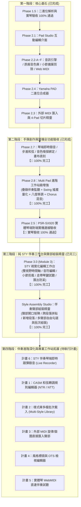

# Yamaha PSR-SX920 伴奏 / 打擊墊編輯器 — 專案進度存檔與執行藍圖

> **更新時間**：2026-10-19  
> **重大里程碑**：
> 1. 🎉 **Phase 1.5 實琴驗收 100% 通過！**（PSR-SX920 實機二進位解析與重構完全相容）  
> 2. 🎉 **Phase 2.3 外部標準 MIDI 匯入與切片分配精靈全面完工！**  
> 3. 🎉 **Phase 2.7 琴端手彈即時錄音 (Mode A)、單步步進 (Mode B)、音色嗅探自動綁定 (Direction B) 與畫布手彈步進直刻 100% 完工！**  
> 4. 🎉 **Phase 2.8 Multi Pad 進階工作站級增強 (疊錄伴奏監聽 + Swing 搖擺量化 + 八度移調 + Chorus CC93 混音 + 多音符框選與自訂力度/試聽) 100% 完工！**  
> 5. 🎉 **Phase 2.5 PSR-SX920 實體琴端對端全功能實機驗收 100% 通過！**（包含 Web MIDI 直連、模式 A/B 錄音、音色嗅探綁定、畫布直刻、隨身碟載入、和弦轉調與原廠 DSP 效果驗證無誤）  
> 6. 🎉 **Phase 3.0 (Module 3) 純 STY 伴奏視覺化工作台 100% 完工！**（雙視野時間軸、Track 0 音符編輯、小節動態剪裁、琴鍵試聽、雷射紅走帶遊標、SFF2 CASM 完整保留與匯出防呆驗證）  
> 7. 🎉 **Style Section Assembly Studio 伴奏聲部組裝精靈 100% 完工！**（聲部開口矩陣、跨段落/跨風格自由拼貼、小節循環填滿、移調力度縮放、新增自訂段落、多聲部自由勾選與批次組裝）  
> 8. 🎉 **Phase 3.6 實體琴 Style 伴奏音色退化 (Fallback to Piano) 重大問題攻堅 100% 完工！**（突破 Yamaha 伴奏引擎三大硬體相容限制：Bank LSB 112 違法無效修正為 XG Capital 0、SInt 初始化第 1 小節獨立隔離防止段落撞車、注入原廠 Style Header 與 XG On SysEx，已完成 PSR-SX920 實機驗收）  
> 9. 📌 **正式將【4 大主題式整合執行包 (樣式庫抽屜混血 / 外部MIDI樂句採集器與C根音校正 / STY琴端即時跟彈錄音 / Yamaha出廠規格封裝與高級轉調試聽)】納入待執行庫！詳細請見：[`PENDING_EXECUTION_PLANS.md`](file:///d:/Vibe%20Coding/MIDI/PENDING_EXECUTION_PLANS.md)**  
> 10. 🎉 **【整合包 1】伴奏樣式庫抽屜與跨風格混血拼貼 (Multi-Style Pool & Cross-Style Remixing) 100% 完工！**（支援 5~10 個 STY 風格拖曳載入記憶體庫、右側滑入式樣式庫抽屜、獨立卡片試聽、拍號/BPM/長度相容性檢測引擎、所選合奏試聽與首創「🎛️ 跨風格拼裝預覽試聽 (Hybrid Preview)」）。  
> **代碼倉庫**：`https://github.com/CMChen59/Yamaha-Midi-Edit.git`（分支: `main`，已同步推播遠端備份）  
> **測試狀態**：160 / 160 項單元測試全數通過（通過率 100%），28 個測試套件全數綠燈通過，TypeScript 編譯 0 錯誤，Vite 生產打包無誤。

---

## 一、 最新核心成果與功能攻堅記錄

### 1. Phase 2.7：琴端實體彈奏即時錄音與單步步進和弦直刻 (已完工)
* **模式 A（即時節拍器錄音與智慧量化）**：
  * 支援 1 小節預備拍倒數（高低木魚音頻 + 視覺燈號）。
  * 節拍器音量獨立滑桿微調、防重疊發聲之電腦監聽開關。
  * 智慧量化對齊（1/16、1/8 拍），自動修成人手彈奏搶拍/拖拍誤差，同時完整保留實彈觸鍵力度動態。
* **模式 B（單步步進和弦輸入）**：
  * 步進時間軸時值切換（`1/1` 至 `1/16T` 三連音）。
  * 即時多音和弦聚合辨識器（按下多鍵自動分析並標註 `C`、`Am`、`G7` 等和弦名稱）。
  * 快捷控制：`Space` 留白插入休止符、`Backspace` 單步撤銷、`+` / `Shift+T` 延長前音 (Tie)。
  * 滾動步進歷史卷軸（Step History Roll Strip）視覺化卡片。
* **方向 B（音色嗅探自動綁定至 Pad）**：
  * 雙向 Web MIDI 實體琴音色變更嗅探（自動捕捉 Bank MSB CC0、Bank LSB CC32、Program Change PC）。
  * 內建 `-- 模擬琴端音色 --` 下拉選單（鋼琴、電鋼琴、弦樂、風琴、吉他、貝斯、管樂、鼓組）。
  * 一鍵寫入 Pad 時自動同步更新 Track 混音、Track 0 Marker 螢幕圖標代碼（`I1~I4`）、聲部混音表格與卡片下拉選單。
* **鋼琴卷軸畫布手彈步進直刻 (`[🎹 手彈步進: 開]` )**：
  * 免開彈窗，直接在主畫面鋼琴卷軸工具列啟用。
  * 點擊畫布任意拍位或音符自動定位游標。
  * 彈奏實體琴鍵（或電腦鍵盤），音符直接印入畫布並自動前進到下一拍。

---

### 2. Phase 2.3：外部標準 MIDI (.mid / .midi) 匯入與切片分配精靈 (已完工)
* **SMF 深度剖析與軌道分離 (`MidiImporter`)**：支援 SMF 0 / 1 格式，自動識別樂器 PC、音符總數、小節長度。
* **4-Pad 自由切片與時間軸重定位**：將外部 MIDI 任意小節區間（如 1~4 小節）切片並重定起始 Tick 至 0。
* **二進位 CASM 轉調與 OTS 注入**：合成標準 Yamaha PSR-SX920 SFF2 CASM 轉調控制區塊。
* **內建 4 軌示範 MIDI (`demo_groove.mid`)**：一鍵載入示範 Groove。

---

### 3. Phase 2.2-F & Phase 2.5：Web MIDI 實體琴硬體直連與全功能實機驗收 (已完成)
* **USB-to-Host 直連免驅動**：利用瀏覽器原生 Web MIDI API，自動握手 PSR-SX920。
* **原廠音色與混音雙向同步**：Bank Select (CC0/CC32) 與 Program Change，混音推桿同步 CC7 (Volume)、CC10 (Pan)、CC91 (Reverb)、CC93 (Chorus)。
* **多重發聲路由與防掛音保護**：切換時廣播 CC 123 (All Notes Off) 與 CC 120 (All Sound Off)。
* **實琴端對端驗收**：隨身碟載入 `.PAD` 檔案於 PSR-SX920 實體按鈕 1~4 回放、Repeat 循環與 Chord Match 和弦轉調實測 100% 正常。

---

### 4. Phase 3.7 / 整合包 1：伴奏樣式庫抽屜與跨風格混血拼貼 (已完工)
* **樣式庫抽屜面板 (Style Library Drawer)**：
  * 右側滑入式現代抽屜，支援多個 `.sty` 伴奏風格檔拖曳暫存與本地多選載入（5~10 個）。
  * 卡片顯示風格標題、BPM、拍號、段落清單與相容性標籤。
  * 卡片支援「▶ 試聽風格」獨立播放發聲與「📌 設為組裝來源」。
* **相容性自動檢測引擎 (`StyleCompatibilityChecker`)**：
  * 即時計算拍號相容性（如 4/4 vs 3/4）、BPM 差距（>15 BPM 提示、>30 BPM 強烈警告）及小節長度差異。
  * 組裝精靈頂部以動態彩色橫幅提示製作人，避免音樂結構衝突。
* **跨風格拼裝預覽試聽 (`Hybrid Section Preview`)**：
  * 革命性即時混血預聽機制：以目標段落未被替換之聲部為底座，實時混入來源風格選定聲部。
  * 不需提前寫入檔案即可耳聽為憑確認混血成果。
* **多聲部自由勾選與批次無損組裝**：
  * 支援跨風格聲部隨意混搭（如 A 風格鼓 + B 風格貝斯 + C 風格吉他），一鍵無損注入目標段落，CASM 轉調與音色完全相容 Yamaha 琴端。

---

## 二、 完整執行進度路線圖 (Master Roadmap)

---

## 三、 詳細執行計畫清單 (Task Breakdown)

| 步驟編號 | 核心功能名稱 | 當前狀態 | 成果與驗收標準 |
| :--- | :--- | :---: | :--- |
| **Phase 2.1** | Pad Studio 互動面板與雙向連動 | **✅ 已完成** | Pad 名稱、CM、RP、圖標代碼、音量推桿、Pan、混響修改與導出 |
| **Phase 2.2-A~E** | 播放引擎、原廠音色庫、音符微調、小節剪除複製 | **✅ 已完成** | 屬性檢查器、拖曳縮放平移、力度軌道、小節複製/剪除/清空 |
| **Phase 2.4** | Yamaha PAD 二進位合成器與空白專案建立 | **✅ 已完成** | 從零建立標準空白 PAD 專案，SFF2 CASM 轉調注入 |
| **Phase 2.2-F** | Web MIDI 實體琴直連與雙向同步 | **✅ 已完成** | USB 直連免驅動、實體琴原廠音色同步、三向路由與防掛音 |
| **Phase 2.3** | 外部標準 MIDI 匯入與 4-Pad 切片分配 | **✅ 已完成** | SMF 解析、軌道獨立試聽、4-Pad 自由小節切片與 PAD 專案合成 |
| **Phase 2.7** | 琴端手彈即時錄音、單步步進、音色嗅探自動綁定 | **✅ 已完工** | 模式 A (預備拍+智慧量化)、模式 B (步進和弦+撤銷/延音)、音色嗅探綁定、畫布手彈直刻 |
| **Phase 2.8-A** | **多打擊墊疊錄伴奏監聽 (Multi-Pad Overdub)** | **🎉 已完工** | **獨立伴奏匯流排、動態 Pad 伴奏選單、獨立音量滑桿 (0~100%)、含伴奏試聽切換** |
| **Phase 2.8-B** | **Swing 搖擺量化與整軌八度移調 (Groove/Shift)** | **🎉 已完工** | **1/16 Swing (54%, 60%, 66%) 搖擺律動量化、畫布一鍵升/降八度 (+12/-12)、Shift+↑/↓ 快捷鍵** |
| **Phase 2.8-C** | **Chorus (合唱效果 CC93) & 混音深度擴充** | **🎉 已完工** | **混音推桿 CC93 (0~127)、Web Audio 立體聲雙路微延遲 LFO 顫動效果器、PSR-SX920 原廠 DSP CC93 雙向即時同步** |
| **Phase 2.5** | **PSR-SX920 實體琴全功能端對端實機驗收** | **🎉 驗收通過** | **Web MIDI 雙向通訊、模式 A/B 錄音、音色嗅探綁定、隨身碟插琴回放、CM 和弦轉調與 RP 循環驗收全數合格** |
| **Phase 3.0** | **純 STY 伴奏工作台 (Module 3)** | **🎉 100% 完工** | **雙視野時間軸、Track 0 音符編輯、小節動態剪裁延伸、雷射紅走帶/琴鍵試聽、SFF2 CASM 完好保留與匯出防呆** |
| **Style Assembly** | **伴奏聲部組裝精靈 (Studio)** | **🎉 100% 完工** | **聲部開口矩陣 (Option A)、跨段落拼貼 (Option B)、新增自訂段落、多聲部自由勾選與批次組裝 (Requirement 3)** |
| **Pending Plans** | **5 大後續進階計畫 (詳見清單)** | **📌 待執行庫** | **CASM 和弦轉調規則 / 樣式庫多檔批次載入 / 外部 MIDI 匯入 / OTS 編輯 / WebMIDI 琴端直連** |

---

## 四、 Phase 2.8：Multi Pad 進階工作站級增強設計規格

### 模組 2.8-A：多打擊墊疊錄伴奏監聽 (Multi-Pad Overdub Backing Track) - 【✅ 已完工】
- **需求情境**：錄製 Pad 2（貝斯）或 Pad 3（吉他）時，背景可同步循環播放已經錄好的 Pad 1（鼓點），讓彈奏者的節奏感與和弦進程完全對齊。
- **成果實現**：
  1. **獨立音訊匯流排**：Web Audio 建立專屬 `backingGain` 節點直通主混音，具備獨立生命週期與 Panic 機制，完全不干擾當前錄音軌道或試聽軌道。
  2. **動態伴奏選單**：`#rec-backing-track-select` 自動嗅探當前專案中已具備音符內容的其他 Pads，提供「無 (不播放)」、「所有已錄製 Pads (全軌混音)」及單一 Pad 選項，並於切換目標 Pad 時即時動態刷新。
  3. **獨立音量調節**：`#rec-backing-vol` (0% ~ 100%，預設 60%) 伴奏滑桿，可動態線性調整，防止伴奏過大蓋過錄音節拍器或正在彈奏的音符。
  4. **錄音與試聽連動**：模式 A 預備拍結束進入錄音時背景伴奏自動進拍循環；提供 `[🎧 含伴奏試聽: 開/關]` 切換按鈕，可一鍵試聽單軌錄音效果或多軌合奏融合度。

### 模組 2.8-B：Swing 搖擺律動量化與整軌八度移調 (Groove/Swing & Octave Shift) - 【✅ 已完工】
- **需求情境**：
  - 放克 (Funk)、搖擺樂 (Swing)、爵士 (Jazz) 與 R&B 打擊樂需要具備非嚴格網格的「微延遲搖擺感（Groove）」。
  - 鍵盤手常需要快速將整軌低音貝斯降八度，或將弦樂升高八度。
- **成果實現**：
  1. **Swing 搖擺律動核心 (`PadRecorder.snapTickToGrid`)**：支援 `1/16 Swing (54%)`、`1/16 Swing (60%)`、`1/16 Swing (66% 三連音)`、`1/8 Swing (60%)`，以反拍動態推移比率精確計算 Tick 座標。
  2. **雙重支援情境**：
     - **即時錄音前置量化**：錄音彈窗量化選單直接選擇 Swing 規格，彈奏錄完即自動帶有專業律動。
     - **鋼琴卷軸後製一鍵量化**：上方工具列提供 `[🎛️ 量化: 1/16 Swing (60%) ▾]` + `[套用量化]` 按鈕，支援選取單音或整軌一鍵吸附。
  3. **八度快速移調工具 (`YamahaPadModifier.shiftPadOctave`)**：
     - 工具列一鍵按鈕：`[🔽 降八度 (-12)]` / `[🔼 升八度 (+12)]`。
     - 鍵盤快捷鍵：`Shift + ↑`（升八度）與 `Shift + ↓`（降八度）。
     - 具備 0~127 MIDI 邊界防呆保護與即時單音試聽回饋。
  4. **單元測試 100% 通過**：新增 `tests/groove-quantize-octave.test.ts`（10 項測試），全案 81/81 項測試全數綠燈通過。

### 模組 2.8-C：Chorus (合唱效果 CC93) & 混音深度擴充 - 【✅ 已完工】
- **需求情境**：Yamaha PSR-SX920 原廠每個 Pad 軌道除 Volume (CC7)、Pan (CC10)、Reverb (CC91) 外，皆配備獨立 Chorus (CC93) 合唱深度調節，能顯著增強電鋼琴、弦樂與吉他的立體空間厚度。
- **成果實現**：
  1. **Yamaha 二進位讀寫支援 (`YamahaPadModifier.setPadMixing`)**：
     - 擴充 `setPadMixing` 支援 `chorus?: number`，自動更新或插入 MIDI CC 93（0~127），並重構 `rawChunk` 確保導出 `.pad` 二進位規格 100% 完整相容 Yamaha 硬體規格。
  2. **Web MIDI 實體琴硬體直連 (`MidiManager.sendMixerControllers`)**：
     - 拖動合唱推桿時，即時向 PSR-SX920 傳送 `[0xB0 | ch, 93, val]`，直接啟動 Yamaha 硬體內部強大的立體聲 Chorus/Flanger/Celeste DSP 特效處理器。
  3. **Web Audio 瀏覽器端立體聲合唱效果器 (Dual-Delay Modulated LFO)**：
     - 在 `AudioEngine` 內建立體聲合唱效果匯流排（L: 24ms, R: 31ms 雙路微延遲），掛載雙路低頻震盪器（LFO 1.2Hz / 1.5Hz，2.5ms~3.0ms 調變深度），並經立體聲合併器匯入主壓縮器。
     - 電腦端瀏覽器預聽時拉高合唱深度，即可清楚聽到聲音寬度向兩側展開、泛音產生柔和顫動的合唱質感。
  4. **UI 混音面板與雙向連動 (`renderParts`)**：
     - 聲部表格新增「合唱 (Chorus)」標題與滑桿（0~127），即時顯示數值標籤，連動二進位修改與實體琴 MIDI 傳送。
  5. **單元測試 100% 通過**：新增 `tests/chorus-mixing.test.ts`，全專案 15 組測試檔共 83/83 項測試全數綠燈通過。

### 模組 2.8-D：琴端錄音音色選取彈窗階層修復與防疊音自動防護 - 【✅ 已完工】
- **問題回饋與診斷**：
  1. **音色視窗被遮蔽**：在錄音彈窗點擊 `[🔍 挑選音色 (Data List)]` 時無反應，關閉錄音彈窗後才看見音色視窗（原因：`#voice-search-modal` 與 `#pad-record-modal` 均為 `z-index: 9999`，DOM 順序導致錄音視窗遮蓋音色視窗）。
  2. **實彈發出雙重聲音**：實體琴彈奏時，琴端喇叭同時發出琴本身音色與電腦鋼琴聲（原因：電腦監聽透過 USB 音訊回傳至 PSR-SX920 喇叭）。
  3. **自選音色未辨識**：PSR-SX920 原廠面板切換音色預設未開啟 Program Change (PC) 傳送，需手動勾選或直接由軟體派送。
- **成果實現**：
  1. **CSS 彈窗層級提升 (`#voice-search-modal`)**：將音色搜尋視窗 z-index 提升至 `10500`，點擊即時浮現在錄音視窗最上層，選取套用後自動關閉並回到錄音視窗。
  2. **防疊音自動靜音防護**：偵測到實體 MIDI 琴連線時，電腦監聽預設自動切換為 `[🔇 電腦監聽: 關]`，確保琴端純淨原音零延遲發聲。
  3. **雙向音色即時連動**：錄音彈窗整合 `[🔍 挑選音色 (Data List)]` 與快捷音色下拉選單，選取後立即發送 MIDI Program Change 同步實體 PSR-SX920，並更新 Pad 設定與嗅探標籤。
  4. **全專案單元測試**：15 組測試檔共 83/83 項測試 100% 通過。

### 模組 2.8-E：多音符框選/複選與批次屬性編輯 (Multi-Note Selection & Batch Editor) - 【✅ 已完工】
- **需求情境（情境 C）**：
  - 使用者在編輯 Multi Pad 時，能以滑鼠框選或 Ctrl 複選一次圈選多顆音符，進行批次一次性調整（力度調大/調小/統一、移調、長度縮放、網格吸附量化、位置平移、批次刪除與試聽）。
- **成果實現**：
  1. **畫布多選與框選互動 (`drawNoteRoll` & `setupCanvasHoverEvents`)**：
     - **滑鼠拖曳框選 (Marquee Box Selection)**：在畫布空白處按住左鍵拖曳，即時渲染半透明亮藍色與虛線選取框，放開滑鼠一次選取框內所有音符。
     - **按住 Ctrl 點選複選**：支援反向切換（加選未選音符、減選已選音符），未按 Ctrl 點選單音則切換為單選，點擊空白處取消選取。
     - **快捷鍵全選**：支援 `Ctrl + A` 一鍵全選當前 Pad 畫布所有音符、`Esc` 一鍵取消選取。
     - **高亮視覺反饋**：選取音符統一呈現琥珀金邊框與立體光暈。
  2. **檢查器切換為批次工具列 (`#multi-note-inspector`)**：
     - 當選取 >1 顆音符時，檢查器無縫切換為批次調整工具列：
       - **🎚️ 力度批次調整**：
          - **自訂數值輸入**：專屬力度數字輸入框 `<input type="number" id="batch-vel-input" min="1" max="127">` 與 `[套用]` 按鈕，支援直接手動鍵入任何數值（如 75, 95, 110 等）並按 `Enter` 或點擊立即統一套用，修改後立即即時試聽新力度動態反饋。
          - **相對微調**：`[ -10 ]` / `[ +10 ]` 相對增減（保持人手演奏強弱比例）。
          - **快速範本**：固定力度下拉選單（Soft 60、Medium 80、Standard 100、Hard 120、Max 127）。
       - **🎵 移調批次調整**：`[ -8度 ]` / `[ ▼ -1半音 ]` / `[ ▲ +1半音 ]` / `[ +8度 ]`，支援方向鍵 `↑` / `↓`（半音）與 `Shift + ↑` / `Shift + ↓`（八度），具備 0~127 邊界防呆保護。
       - **⏱️ 音長批次縮放**：`[ 50% 斷奏 ]` / `[ 80% 跳音 ]` / `[ 100% 滿格 ]` / `[ 120% 連音 ]`。
       - **🎛️ 網格批次量化**：`[ 🎛️ 吸附量化 ]` 一鍵將選取音符吸附至當前選定的 1/16 或 Swing 律動網格。
       - **↔️ 位置批次平移**：`[ ⏪ 1小節 ]` / `[ ◀ 1拍 ]` / `[ 1拍 ▶ ]` / `[ 1小節 ⏩ ]`，亦支援鍵盤方向鍵 `←` / `→`。
       - **▶ 批次短句試聽**：新增 `AudioEngine.playAuditionPhrase`，點擊瞬間同步喚醒 Web Audio，支援和弦同發與小節短句時序排程，並在 Web MIDI 直連實體琴時執行單次音色切換防抖，徹底杜絕多重 Program Change 造成 Yamaha SX920 合成器引擎重置斷音。
       - **🗑️ 批次刪除**：一鍵批次刪除所有選取音符，支援鍵盤 `Delete / Backspace`。
  3. **二進位處理效能 (`YamahaPadModifier.batchUpdateNotes` & `batchDeleteNotes`)**：
     - 記憶體批次比對與更新，末端僅單次重新計算 Delta Times 與重構 Track Chunk，極致 60FPS 流暢且支援 `Ctrl + Z` 一鍵復原。
  4. **單元測試 100% 通過**：新增 `tests/batch-note-editing.test.ts`，全專案 16 組測試檔共 88/88 項測試全數綠燈通過。

---

## 五、 Phase 3.0：外部 MIDI 轉 Yamaha Style 伴奏風格 (.sty) 精靈

### 階段 3.1：Style 核心二進位結構與 SFF2 CASM 伴奏合成引擎 (Core Binary Engine) - 【✅ 已完工】
- **需求與 Yamaha 原廠規範**：
  - 與 Multi Pad (.PAD) 可支援 SMF 1 多軌不同，Yamaha Style (.STY) 檔案**嚴格要求採用 SMF 0 (Format 0) 單軌架構**。
  - 所有的 8 個標準伴奏通道（Channels 8~15，對應樂器面板 MIDI Channel 9~16）與所有曲式段落標記（Section Markers：`Intro`、`Main A~D`、`Fill In`、`Ending` 等）全部交織在 Track 0。
  - 必須包含標準 Yamaha SFF2 `CASM` 二進位自訂區塊（包含 `CSEG`、`Sdec` 與 47-byte `Ctb2` Chord Table），琴端左手和弦識別才能正確自動轉調。
- **成果實現**：
  1. **Style 核心資料模型 (`src/core/models/style-types.ts`)**：
     - 定義 `StylePartId`（Rhythm1, Rhythm2, Bass, Chord1, Chord2, Pad, Phrase1, Phrase2）。
     - 定義 8 大聲部預設通道、預設音色、音量 (CC7)、音場 (CC10)、殘響 (CC91)、合唱 (CC93) 及轉調規則。
     - 定義 `StyleSectionType`、`StyleSectionConfig`、`StyleNoteEvent` 及 `NewStyleProjectOptions`。
  2. **Style 二進位合成引擎 (`src/core/writer/style-synthesizer.ts`)**：
     - `createBlankStyle()`：精確生成 Format 0 單軌 Style 結構，軌道開頭寫入 `SFF2` 與 `SInt` 標記、拍號、Tempo、8 聲部控制器初始化（Bank MSB/LSB, PC, Vol, Pan, Exp, Rev, Cho），並按小節間距精確注入段落標記與音符。
     - `buildStandardStyleCasm()`：合成 100% 符合 Yamaha SFF2 規範之 CASM Chunk，為 8 聲部生成 47-byte `Ctb2` 和弦變換表（Rhythm 軌 Bypass 直通、Bass 根音轉調、和弦/長音/裝飾句支援全音域和弦轉換）。
     - `getMusicalSections()`：智慧分離過濾掉開頭 SFF2/SInt 系統標頭標記，提供乾淨的音樂段落清單。
     - `serializeToStyleFile()`：直接輸出標準 `.sty` 二進位 Uint8Array，可供硬體或解析器讀取。
  3. **單元測試 100% 通過 (`tests/style-synthesizer.test.ts`)**：
     - 驗證 SMF 0 單軌架構與 8 伴奏通道。
     - 驗證 SFF2 CASM 區塊完整性與 Ctb2 和弦表長度。
     - 驗證多段落音符注入與 `YamahaParser.parse(..., 'STY')` 雙向回讀。
     - 全專案 17 組測試檔共 92/92 項測試全數綠燈通過。

---

### 階段 3.2：外部 MIDI 匯入分流與 8 聲部智慧映射精靈 (Import Router & 8-Part Intelligent Mapper) - 【✅ 已完工】
- **需求與成果實現**：
  1. **外部 MIDI 匯入分流導航 (Import Mode Router, `#midi-mode-router-modal`)**：
     - 拖入或選取 `.mid` / `.midi` 檔案時，主動喚醒分流引導視窗：
       - `[🎛️ 轉為 Multi Pad 打擊墊 (.PAD)]`：進入 4-Pad 獨立短句切片與即時拍擊觸發精靈。
       - `[🎼 轉為 Yamaha Style 伴奏 (.STY)]`：進入 8 聲部智慧伴奏映射精靈。
     - 徹底杜絕格式混淆，為 Multi Pad 與 Style 伴奏雙軌工作流建立清晰入口。
  2. **8 聲部智慧特徵分析與推薦演算法 (`StyleImporter.analyzeForStyle`)**：
     - 自動解析各音軌音樂特徵（音符數、通道、PC 音色、平均音高、平均時值、同發多音比率 Polyphony Ratio）。
     - 智慧樂器分類：鼓組 (Drums)、打擊樂 (Percussion)、低音 (Bass)、鋼琴鍵盤 (Piano)、吉他 (Guitar)、弦樂 (Strings)、長音 (Pad)、銅管 (Brass)、木管 (Reed)、主奏 (Lead)。
     - 智慧裁決分配防衝突演算法：
       - `MIDI Ch 10` 或鼓組 -> 主爵士鼓組 `Rhythm 2`；次打擊樂 -> `Rhythm 1`。
       - 低音音色與音域 (PC 32~39 或 Avg Pitch <= 48) -> 低音貝斯 `Bass`。
       - 和弦同發演奏 (Polyphony Ratio >= 0.25) -> 節奏主和弦 `Chord 1`；次和弦/管樂組 -> `Chord 2`。
       - 長音與鋪底音色 -> 長音背景 `Pad`。
       - 分解琶音 (Arpeggio) 或單音主奏短句 -> 對位短句 `Phrase 1`；副裝飾句 -> `Phrase 2`。
  3. **8 聲部可視化映射調整介面 (`#style-import-modal`)**：
     - 左欄呈現來源 MIDI 軌道卡片、樂器分類標籤、音符數、推薦聲部與單軌即時試聽按鈕 (`[▶ 試聽]`)。
     - 右欄呈現 Yamaha 8 伴奏聲部卡片（Rhythm 1~2, Bass, Chord 1~2, Pad, Phrase 1~2），提供來源下拉選單、智慧推薦已套用標籤、`-36~+36` 移調數值與 `[-12] [0] [+12]` 快捷鍵、單軌試聽按鈕。
     - 支援一鍵快速動作：`[⚡ 8 聲部智慧推薦一鍵映射]`、`[🔄 全部清空]`。
  4. **標準 Style 伴奏合成與即時載入工作區 (`executeStyleImport`)**：
     - 依據選定小節切片（如 1~4 小節或 1~8 小節）與聲部映射，呼叫 `StyleImporter.synthesizeStyleFromImport`。
     - 精確生成符合 Yamaha SFF2 CASM 規範之 SMF 0 單軌 Style 檔案，並直接無縫載入主畫面（支援 CASM 檢視、段落標記、走帶與聲部混音）。
  5. **試聽切片對齊、零乾等即時發聲、發聲路由與 8 聲部合奏試聽 (`toggleStyleTrackAudition` & `toggleStyleEnsembleAudition`)**：
     - **彈窗內建發聲來源與實體琴連線控制條**：彈窗直接整合發聲路由下拉選單（`💻+🎹 雙出`、`🎹 僅實體琴 PSR-SX920`、`💻 僅電腦喇叭`）、Web MIDI 設備切換選單、連線按鈕與 `[🔔 測試連線]`，所有狀態與主畫面頂部連線膠囊無縫即時雙向連動同步。
     - **Yamaha 原廠伴奏專屬通道 (Ch 9~16) 與真實鼓組音色對齊**：合奏試聽自動指派 8 大聲部至原生 Yamaha 伴奏通道（Ch 8~15，即樂器面板 Ch 9~16），鼓組音軌自動載入 Yamaha Drum Kit Bank（MSB 127, LSB 0），徹底杜絕不同聲部在同一通道互相踩音與鼓組變鋼琴聲問題。
     - **切片對齊試聽**：試聽按鈕自動對齊使用者所設定的切片小節（例如第 1~8 小節），若該軌在選定小節尚未進場，自動平移至該軌第一顆音符所在的真正開口小節，徹底消除數十秒的無聲乾等。
     - **真實合成音色匹配**：鼓組 (Ch 10) 嚴格以鼓組音色發聲，貝斯、鋼琴、吉他、弦樂均自動對應正確的合成音色。
     - **`[🎧 試聽所選小節合奏]` 一鍵多軌伴奏試聽**：整合 `AudioEngine.startBackingTrack`，在建立 Style 之前即可一鍵同時聆聽 8 個聲部在選定小節一起演奏的整體編曲融合度。
  6. **單元測試 100% 通過 (`tests/style-importer.test.ts`)**：
     - 涵蓋特徵剖析、8 聲部防衝突分配、伴奏合成二進位 Roundtrip 回讀、自訂移調與控制器覆寫。
     - 全專案 18 組測試檔共 96/96 項測試全數綠燈通過。

---

### 階段 3.3~3.6 核心攻堅進度與後續整合計畫：
- **階段 3.3~3.5 (已完工 100%)**：
  - `Style Section Assembly Studio` 伴奏聲部組裝精靈全面完工（包含 8 聲部開口矩陣、跨段落/跨風格組裝、新增段落與多聲部批次組裝）。
  - Track 0 鋼琴卷軸雙視野音符編輯、小節動態剪裁、雷射走帶琴鍵試聽與匯出防呆驗證完成。
- **階段 3.6 (已完工 100%)**：
  - 突破 Yamaha 琴端伴奏引擎音色退化為鋼琴 (Fallback to Piano) 之重大硬體相容問題（修正 Bank LSB 0、隔離 SInt 第 1 小節、注入原廠 Style Header 與 XG On SysEx，已完成 PSR-SX920 實機驗收）。

### 🚀 2026-10-19 全新收斂之 4 大主題式整合執行包 (詳見 `PENDING_EXECUTION_PLANS.md`)：
1. **【整合包 1】伴奏樣式庫抽屜與跨風格混血拼貼 (Multi-Style Pool & Cross-Style Remixing)**
   - 擴充樣式庫多檔拖曳暫存抽屜，跨檔案自由抽件組裝（如 A 風格鼓 + B 風格貝斯 + C 風格吉他），速度/拍號智慧對齊。
2. **【整合包 2】外部 MIDI 樂句採集器與 C 根音校正 (MIDI Section Sampler & C-Root Normalizer)**
   - 載入外部 MIDI 歌曲，時間軸精準圈選 2~8 小節，關鍵「C 根音校正」演算法自動將原曲移調為 C 調基準，徹底解決 Yamaha 琴端左手換和弦走音打架問題。
3. **【整合包 3】STY 伴奏聲部琴端即時跟彈錄音 (STY Live Metronome Overdub Recorder)**
   - 將 Multi Pad 成熟的跟彈錄音、4 拍預備拍節拍器、1/16 與 1/8 智慧量化、多軌背景伴奏疊錄監聽完整移植至 STY 伴奏各聲部。
4. **【整合包 4】Yamaha 出廠規格封裝與高級轉調試聽 (CASM NTR/NTT + OTS 1~4 + 虛擬和弦測試條)**
   - CASM 轉調規則編輯（Root Trans / Fixed）、風格標頭與 OTS 1~4 右手音色設定、畫面虛擬和弦測試條（C, F, G7, Am 模擬琴端轉調聽感）。

---

## 六、 待討論與優化議題記錄庫 (Pending Optimization & Discussion Backlog)

### 📌 議題 BACKLOG-01：多 Pad 合奏播放時非第 1 小節進場 Pad 之視覺等待狀態呈現優化
* **當前狀態**：**【✅ 已由 STY 第 1 小節對齊與休止標註化解，正式歸檔】**
* **解決說明**：
  * 在 STY 伴奏工作台中確立了專業 DAW 規範：「時間軸一律自第 1 小節 (Tick 0) 起始對齊，前方未演奏處如實呈現空白休止小節 (Resting Measures)」。
  * 此規範已於 Commit `59d00ab` 同步回 PAD 模式。走帶雷射游標從第 1 小節掃過前導休止小節是標準音樂時序，畫布頂部亦清楚標註「第 X 小節開始演奏」，視覺與聽覺認知完全一致，無違和感。

### 📌 議題 BACKLOG-02：選取音符批次搬移/複製至其他 Pad 換音色 (Move/Copy Notes to Pad X)
* **議題性質**：編曲與聲部分流功能擴充（Arrangement & Voice Splitting）
* **當前狀態**：**【已收錄於附屬擴充包，隨時可於鋼琴卷軸批次檢查器擴充】**
* **核心方案**：選取音符後，批次工具列提供 `[➡️ 搬移至 Pad 2/3/4]` 與 `[📋 複製至 Pad 2/3/4]`，一鍵創造雙樂器立體聲對位。

### 📌 議題 BACKLOG-03：打擊樂軌道 (Drum Kit) 選取音符批次替換樂器打擊聲音 (Drum Note Voice Replacement)
* **議題性質**：打擊樂音色映射與替換（Drum Instrument Remapping）
* **當前狀態**：**【已收錄於附屬擴充包，隨時可於鋼琴卷軸批次檢查器擴充】**
* **核心方案**：Channel 10 鼓組軌道一鍵選取所有小鼓/邊擊鼓，批次下拉映射替換為其他打擊樂器音高。
