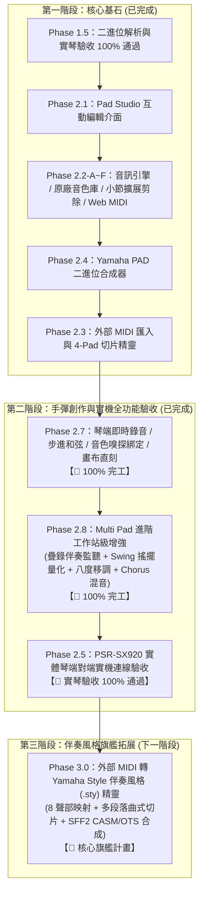

# Yamaha PSR-SX920 伴奏 / 打擊墊編輯器 — 專案進度存檔與執行藍圖

> **更新時間**：2026-10-16  
> **重大里程碑**：
> 1. 🎉 **Phase 1.5 實琴驗收 100% 通過！**（PSR-SX920 實機二進位解析與重構完全相容）  
> 2. 🎉 **Phase 2.3 外部標準 MIDI 匯入與切片分配精靈全面完工！**  
> 3. 🎉 **Phase 2.7 琴端手彈即時錄音 (Mode A)、單步步進 (Mode B)、音色嗅探自動綁定 (Direction B) 與畫布手彈步進直刻 100% 完工！**  
> 4. 🎉 **Phase 2.8 Multi Pad 進階工作站級增強 (疊錄伴奏監聽 + Swing 搖擺量化 + 八度移調 + Chorus CC93 混音) 100% 完工！**  
> 5. 🎉 **Phase 2.5 PSR-SX920 實體琴端對端全功能實機驗收 100% 通過！**（包含 Web MIDI 直連、模式 A/B 錄音、音色嗅探綁定、畫布直刻、隨身碟載入、和弦轉調與原廠 DSP 效果驗證無誤）  
> 6. 📌 **正式將【Phase 3.0：MIDI 轉 Yamaha Style 伴奏風格 (.sty) 精靈】納入下一階段核心旗艦衝刺計畫！**  
> **代碼倉庫**：`https://github.com/CMChen59/Yamaha-Midi-Edit.git`（分支: `main`）  
> **測試狀態**：83 / 83 項單元測試全數通過（通過率 100%），15 個測試套件全數綠燈通過，TypeScript 編譯 0 錯誤，Vite 生產打包無誤。

---

## 一、 最新核心成果與功能攻堅記錄

### 1. Phase 2.7：琴端實體彈奏即時錄音與單步步進和弦直刻 (已完工)
* **模式 A（即時節拍器錄音與智慧量化）**：
  * 支援 1 小節預備拍倒數（高低木魚音頻 + 視覺燈號）。
  * 節拍器音量獨立滑桿微調、防重疊發聲之電腦監聽開關。
  * 智慧量化對齊（1/16、1/8 拍），自動修成人手彈奏搶拍/拖拍誤差，同時完整保留實彈觸鍵力度動態。
* **模式 B（單步步進和弦輸入）**：
  * 步進時間軸時值切換（`1/1` 至 `1/16T` 三連音）。
  * 即時多音和弦聚合辨識器（按下多鍵自動分析並標註 `C`、`Am`、`G7` 等和弦名稱）。
  * 快捷控制：`Space` 留白插入休止符、`Backspace` 單步撤銷、`+` / `Shift+T` 延長前音 (Tie)。
  * 滾動步進歷史卷軸（Step History Roll Strip）視覺化卡片。
* **方向 B（音色嗅探自動綁定至 Pad）**：
  * 雙向 Web MIDI 實體琴音色變更嗅探（自動捕捉 Bank MSB CC0、Bank LSB CC32、Program Change PC）。
  * 內建 `-- 模擬琴端音色 --` 下拉選單（鋼琴、電鋼琴、弦樂、風琴、吉他、貝斯、管樂、鼓組）。
  * 一鍵寫入 Pad 時自動同步更新 Track 混音、Track 0 Marker 螢幕圖標代碼（`I1~I4`）、聲部混音表格與卡片下拉選單。
* **鋼琴卷軸畫布手彈步進直刻 (`[🎹 手彈步進: 開]` )**：
  * 免開彈窗，直接在主畫面鋼琴卷軸工具列啟用。
  * 點擊畫布任意拍位或音符自動定位游標。
  * 彈奏實體琴鍵（或電腦鍵盤），音符直接印入畫布並自動前進到下一拍。

---

### 2. Phase 2.3：外部標準 MIDI (.mid / .midi) 匯入與切片分配精靈 (已完工)
* **SMF 深度剖析與軌道分離 (`MidiImporter`)**：支援 SMF 0 / 1 格式，自動識別樂器 PC、音符總數、小節長度。
* **4-Pad 自由切片與時間軸重定位**：將外部 MIDI 任意小節區間（如 1~4 小節）切片並重定起始 Tick 至 0。
* **二進位 CASM 轉調與 OTS 注入**：合成標準 Yamaha PSR-SX920 SFF2 CASM 轉調控制區塊。
* **內建 4 軌示範 MIDI (`demo_groove.mid`)**：一鍵載入示範 Groove。

---

### 3. Phase 2.2-F & Phase 2.5：Web MIDI 實體琴硬體直連與全功能實機驗收 (已完成)
* **USB-to-Host 直連免驅動**：利用瀏覽器原生 Web MIDI API，自動握手 PSR-SX920。
* **原廠音色與混音雙向同步**：Bank Select (CC0/CC32) 與 Program Change，混音推桿同步 CC7 (Volume)、CC10 (Pan)、CC91 (Reverb)、CC93 (Chorus)。
* **多重發聲路由與防掛音保護**：切換時廣播 CC 123 (All Notes Off) 與 CC 120 (All Sound Off)。
* **實琴端對端驗收**：隨身碟載入 `.PAD` 檔案於 PSR-SX920 實體按鈕 1~4 回放、Repeat 循環與 Chord Match 和弦轉調實測 100% 正常。

---

## 二、 完整執行進度路線圖 (Master Roadmap)

---

## 三、 詳細執行計畫清單 (Task Breakdown)

| 步驟編號 | 核心功能名稱 | 當前狀態 | 成果與驗收標準 |
| :--- | :--- | :---: | :--- |
| **Phase 2.1** | Pad Studio 互動面板與雙向連動 | **✅ 已完成** | Pad 名稱、CM、RP、圖標代碼、音量推桿、Pan、混響修改與導出 |
| **Phase 2.2-A~E** | 播放引擎、原廠音色庫、音符微調、小節剪除複製 | **✅ 已完成** | 屬性檢查器、拖曳縮放平移、力度軌道、小節複製/剪除/清空 |
| **Phase 2.4** | Yamaha PAD 二進位合成器與空白專案建立 | **✅ 已完成** | 從零建立標準空白 PAD 專案，SFF2 CASM 轉調注入 |
| **Phase 2.2-F** | Web MIDI 實體琴直連與雙向同步 | **✅ 已完成** | USB 直連免驅動、實體琴原廠音色同步、三向路由與防掛音 |
| **Phase 2.3** | 外部標準 MIDI 匯入與 4-Pad 切片分配 | **✅ 已完成** | SMF 解析、軌道獨立試聽、4-Pad 自由小節切片與 PAD 專案合成 |
| **Phase 2.7** | 琴端手彈即時錄音、單步步進、音色嗅探自動綁定 | **✅ 已完工** | 模式 A (預備拍+智慧量化)、模式 B (步進和弦+撤銷/延音)、音色嗅探綁定、畫布手彈直刻 |
| **Phase 2.8-A** | **多打擊墊疊錄伴奏監聽 (Multi-Pad Overdub)** | **🎉 已完工** | **獨立伴奏匯流排、動態 Pad 伴奏選單、獨立音量滑桿 (0~100%)、含伴奏試聽切換** |
| **Phase 2.8-B** | **Swing 搖擺量化與整軌八度移調 (Groove/Shift)** | **🎉 已完工** | **1/16 Swing (54%, 60%, 66%) 搖擺律動量化、畫布一鍵升/降八度 (+12/-12)、Shift+↑/↓ 快捷鍵** |
| **Phase 2.8-C** | **Chorus (合唱效果 CC93) & 混音深度擴充** | **🎉 已完工** | **混音推桿 CC93 (0~127)、Web Audio 立體聲雙路微延遲 LFO 顫動效果器、PSR-SX920 原廠 DSP CC93 雙向即時同步** |
| **Phase 2.5** | **PSR-SX920 實體琴全功能端對端實機驗收** | **🎉 驗收通過** | **Web MIDI 雙向通訊、模式 A/B 錄音、音色嗅探綁定、隨身碟插琴回放、CM 和弦轉調與 RP 循環驗收全數合格** |
| **Phase 3.0** | **外部 MIDI 轉 Yamaha Style 伴奏風格 (.sty) 精靈** | **🚀 核心旗艦** | **8 聲部映射 (Ch 9~16)、曲式切片 (Main A~D / Fill In / Intro / Ending)、SFF2 CASM 合成** |

---

## 四、 Phase 2.8：Multi Pad 進階工作站級增強設計規格

### 模組 2.8-A：多打擊墊疊錄伴奏監聽 (Multi-Pad Overdub Backing Track) - 【✅ 已完工】
- **需求情境**：錄製 Pad 2（貝斯）或 Pad 3（吉他）時，背景可同步循環播放已經錄好的 Pad 1（鼓點），讓彈奏者的節奏感與和弦進程完全對齊。
- **成果實現**：
  1. **獨立音訊匯流排**：Web Audio 建立專屬 `backingGain` 節點直通主混音，具備獨立生命週期與 Panic 機制，完全不干擾當前錄音軌道或試聽軌道。
  2. **動態伴奏選單**：`#rec-backing-track-select` 自動嗅探當前專案中已具備音符內容的其他 Pads，提供「無 (不播放)」、「所有已錄製 Pads (全軌混音)」及單一 Pad 選項，並於切換目標 Pad 時即時動態刷新。
  3. **獨立音量調節**：`#rec-backing-vol` (0% ~ 100%，預設 60%) 伴奏滑桿，可動態線性調整，防止伴奏過大蓋過錄音節拍器或正在彈奏的音符。
  4. **錄音與試聽連動**：模式 A 預備拍結束進入錄音時背景伴奏自動進拍循環；提供 `[🎧 含伴奏試聽: 開/關]` 切換按鈕，可一鍵試聽單軌錄音效果或多軌合奏融合度。

### 模組 2.8-B：Swing 搖擺律動量化與整軌八度移調 (Groove/Swing & Octave Shift) - 【✅ 已完工】
- **需求情境**：
  - 放克 (Funk)、搖擺樂 (Swing)、爵士 (Jazz) 與 R&B 打擊樂需要具備非嚴格網格的「微延遲搖擺感（Groove）」。
  - 鍵盤手常需要快速將整軌低音貝斯降八度，或將弦樂升高八度。
- **成果實現**：
  1. **Swing 搖擺律動核心 (`PadRecorder.snapTickToGrid`)**：支援 `1/16 Swing (54%)`、`1/16 Swing (60%)`、`1/16 Swing (66% 三連音)`、`1/8 Swing (60%)`，以反拍動態推移比率精確計算 Tick 座標。
  2. **雙重支援情境**：
     - **即時錄音前置量化**：錄音彈窗量化選單直接選擇 Swing 規格，彈奏錄完即自動帶有專業律動。
     - **鋼琴卷軸後製一鍵量化**：上方工具列提供 `[🎛️ 量化: 1/16 Swing (60%) ▾]` + `[套用量化]` 按鈕，支援選取單音或整軌一鍵吸附。
  3. **八度快速移調工具 (`YamahaPadModifier.shiftPadOctave`)**：
     - 工具列一鍵按鈕：`[🔽 降八度 (-12)]` / `[🔼 升八度 (+12)]`。
     - 鍵盤快捷鍵：`Shift + ↑`（升八度）與 `Shift + ↓`（降八度）。
     - 具備 0~127 MIDI 邊界防呆保護與即時單音試聽回饋。
  4. **單元測試 100% 通過**：新增 `tests/groove-quantize-octave.test.ts`（10 項測試），全案 81/81 項測試全數綠燈通過。

### 模組 2.8-C：Chorus (合唱效果 CC93) & 混音深度擴充 - 【✅ 已完工】
- **需求情境**：Yamaha PSR-SX920 原廠每個 Pad 軌道除 Volume (CC7)、Pan (CC10)、Reverb (CC91) 外，皆配備獨立 Chorus (CC93) 合唱深度調節，能顯著增強電鋼琴、弦樂與吉他的立體空間厚度。
- **成果實現**：
  1. **Yamaha 二進位讀寫支援 (`YamahaPadModifier.setPadMixing`)**：
     - 擴充 `setPadMixing` 支援 `chorus?: number`，自動更新或插入 MIDI CC 93（0~127），並重構 `rawChunk` 確保導出 `.pad` 二進位規格 100% 完整相容 Yamaha 硬體規格。
  2. **Web MIDI 實體琴硬體直連 (`MidiManager.sendMixerControllers`)**：
     - 拖動合唱推桿時，即時向 PSR-SX920 傳送 `[0xB0 | ch, 93, val]`，直接啟動 Yamaha 硬體內部強大的立體聲 Chorus/Flanger/Celeste DSP 特效處理器。
  3. **Web Audio 瀏覽器端立體聲合唱效果器 (Dual-Delay Modulated LFO)**：
     - 在 `AudioEngine` 內建立體聲合唱效果匯流排（L: 24ms, R: 31ms 雙路微延遲），掛載雙路低頻震盪器（LFO 1.2Hz / 1.5Hz，2.5ms~3.0ms 調變深度），並經立體聲合併器匯入主壓縮器。
     - 電腦端瀏覽器預聽時拉高合唱深度，即可清楚聽到聲音寬度向兩側展開、泛音產生柔和顫動的合唱質感。
  4. **UI 混音面板與雙向連動 (`renderParts`)**：
     - 聲部表格新增「合唱 (Chorus)」標題與滑桿（0~127），即時顯示數值標籤，連動二進位修改與實體琴 MIDI 傳送。
  5. **單元測試 100% 通過**：新增 `tests/chorus-mixing.test.ts`，全專案 15 組測試檔共 83/83 項測試全數綠燈通過。

### 模組 2.8-D：琴端錄音音色選取彈窗階層修復與防疊音自動防護 - 【✅ 已完工】
- **問題回饋與診斷**：
  1. **音色視窗被遮蔽**：在錄音彈窗點擊 `[🔍 挑選音色 (Data List)]` 時無反應，關閉錄音彈窗後才看見音色視窗（原因：`#voice-search-modal` 與 `#pad-record-modal` 均為 `z-index: 9999`，DOM 順序導致錄音視窗遮蓋音色視窗）。
  2. **實彈發出雙重聲音**：實體琴彈奏時，琴端喇叭同時發出琴本身音色與電腦鋼琴聲（原因：電腦監聽透過 USB 音訊回傳至 PSR-SX920 喇叭）。
  3. **自選音色未辨識**：PSR-SX920 原廠面板切換音色預設未開啟 Program Change (PC) 傳送，需手動勾選或直接由軟體派送。
- **成果實現**：
  1. **CSS 彈窗層級提升 (`#voice-search-modal`)**：將音色搜尋視窗 z-index 提升至 `10500`，點擊即時浮現在錄音視窗最上層，選取套用後自動關閉並回到錄音視窗。
  2. **防疊音自動靜音防護**：偵測到實體 MIDI 琴連線時，電腦監聽預設自動切換為 `[🔇 電腦監聽: 關]`，確保琴端純淨原音零延遲發聲。
  3. **雙向音色即時連動**：錄音彈窗整合 `[🔍 挑選音色 (Data List)]` 與快捷音色下拉選單，選取後立即發送 MIDI Program Change 同步實體 PSR-SX920，並更新 Pad 設定與嗅探標籤。
  4. **全專案單元測試**：15 組測試檔共 83/83 項測試 100% 通過。

---

## 五、 Phase 3.0：外部 MIDI 轉 Yamaha Style 伴奏風格 (.sty) 架構設計

1. **匯入分流導航 (Import Mode Router)**：
   - 拖入 `.mid` 檔案時，彈出情境分流選擇：`[🎛️ 轉為 Multi Pad 打擊墊]` vs `[🎼 轉為 Yamaha Style 伴奏風格]`。
2. **Style 伴奏 8 聲部智慧映射 (8-Part Track Mapping)**：
   - 對應 Yamaha 標準 8 伴奏通道（MIDI Channel 9~16）：
     - `Ch 9 / 10`：Rhythm 1 (打擊樂) & Rhythm 2 (主爵士鼓組)。
     - `Ch 11`：Bass (低音貝斯)。
     - `Ch 12 / 13`：Chord 1 (節奏和弦) & Chord 2 (管樂/副和弦)。
     - `Ch 14`：Pad (長音弦樂背景鋪底)。
     - `Ch 15 / 16`：Phrase 1 & Phrase 2 (主旋律對位與加花裝飾句)。
3. **曲式多段落視覺化切片 (Multi-Section Slicing)**：
   - 時間軸圈選小節切片：`Main A~D`、`Fill In AA~DD`、`Intro A~C`、`Ending A~C`。
4. **SFF2 CASM 轉調與 OTS 二進位合成引擎**：
   - 自動生成標準 Yamaha SFF2 `CASM` 轉調區塊與 `Ctb2`（Chord Table），確保在琴端左手按壓任何和弦皆能原廠規格完美自動伴奏。

---

## 六、 待討論與優化議題記錄庫 (Pending Optimization & Discussion Backlog)

### 📌 議題 BACKLOG-01：多 Pad 合奏播放時非第 1 小節進場 Pad 之視覺等待狀態呈現優化

* **議題性質**：使用者介面視覺體驗優化（Visual UX Enhancement）
* **當前狀態**：**已建檔存查（程式碼維持原版正常音樂邏輯，保留待後續排程討論）**
* **背景與觀察現象**：
  * 在實際的音樂編曲架構中，四個 Pad 不一定都在第 1 小節同時開口，例如：Pad 1 與 Pad 2 在開頭進場，而 **Pad 3 被安排在第 10 小節（或後續段落）才進場**，前面屬於等候期，此為完全正確的音樂編排邏輯。
  * 在執行合奏播放（`[🎼 合奏播放]`）時，若使用者當前畫布正好切換檢視 Pad 3，鋼琴卷軸畫布從整體播放的第 1 小節起就開始跑動綠色走帶指針。
  * 此時聽覺上 Pad 3 尚未進場（無聲），但畫布上的指針卻在音符上移動，造成「尚未到出場時間，畫面上卻看似在播放」的視覺認知落差。
* **核心優化目標**：
  * **維持音樂進場邏輯**：嚴格保持 Pad 各自原本的音樂進場小節與時間點（不強制改動音符發聲起點）。
  * **消除視覺矛盾**：讓尚未進場的 Pad 在畫布上能呈現直觀、合理的「等候狀態」，避免使用者誤以為指針已在播放該軌。
* **後續候選討論方案**：
  1. **方案 A（等待期間指針靜止於起點）**：
     * 當整體播放進度尚未到達該 Pad 的進場小節（例如 Measure 1~9）時，該 Pad 畫布上的指針保持在起點不跑動（或不繪製走帶線）。
     * 直到整體時間軸真正到達第 10 小節時，指針才開始在該 Pad 畫布上順暢掃描與發聲。
  2. **方案 B（畫布半透明等候罩層與狀態標註）**：
     * 尚未進場前，畫布上方標註「⏳ Pad 3 等候進入中 (將於第 10 小節進場)」，畫布輕微半透明淡化。
     * 時間一到，罩層淡出並自動啟動走帶指針。
  3. **方案 C（全域播放小節與各軌進場時序指示）**：
     * 在頂部 Transport 合奏狀態標籤中，顯示各軌的進場時間軸狀態，使操作者一目了然目前整體與各 Pad 的進場進度。
