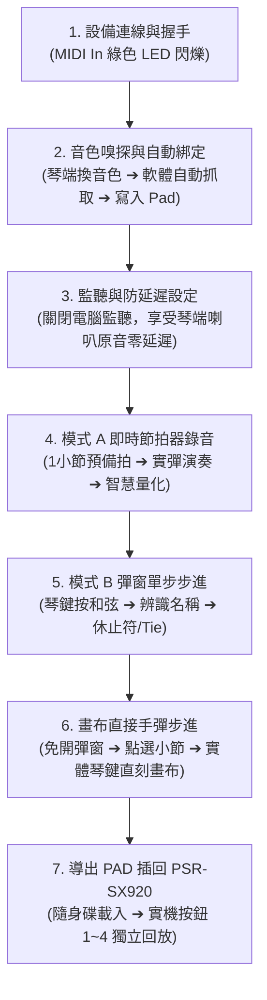

# Yamaha PSR-SX920 琴端實機連線完整驗收手冊

本手冊專門為您回家後將 **Yamaha PSR-SX920 實體琴** 與電腦連線，進行 **琴端即時錄音 (Mode A)、單步步進輸入 (Mode B)、音色嗅探自動綁定 (Direction B)、畫布直接手彈步進、以及 USB 隨身碟插琴回放** 的端對端實機驗收所設計。

依照以下 **7 大步驟流程**，預計 10~15 分鐘即可完成所有核心功能的完整實機驗收！

---

## 🔌 步驟 0：硬體連接與瀏覽器準備

```
┌─────────────────────────┐          USB-AB 方口印表機線          ┌─────────────────────────┐
│   Yamaha PSR-SX920      │ ◄─────────────────────────────────► │     電腦 / 筆記型電腦   │
│  [USB TO HOST] 方口插座 │                                     │      (Chrome / Edge)    │
└─────────────────────────┘                                     └─────────────────────────┘
```

1. **連接線材**：使用一條標準 **USB Type-A 轉 Type-B 方口線**（一般 USB 印表機線）：
   - 方口端（Type-B）插入 PSR-SX920 琴背面的 **`[USB TO HOST]`** 插孔。
   - 扁口端（Type-A 或 Type-C 轉接頭）插入電腦 USB 孔。
2. **開機與瀏覽器**：
   - 開啟 PSR-SX920 電源。
   - 開啟電腦上的 **Google Chrome** 或 **Microsoft Edge** 瀏覽器（原生支援 Web MIDI API）。
   - 打開系統網址：`http://localhost:5173/`。
3. **免裝特殊驅動**：Windows 10/11 會自動以標準通用 USB-MIDI 類別驅動完成連線（若電腦已有安裝 Yamaha 原廠 Steinberg USB 驅動亦可）。

---

## 📋 實機七階段驗收總覽 (Roadmap)



---

### 第一階段：Web MIDI 設備連線與訊號握手驗證

#### 🎯 目的：確認電腦瀏覽器與 PSR-SX920 建立雙向 MIDI 訊號通訊。

1. 進入系統主畫面，點擊頂部或任意 Pad 卡片上的 **`[🔴 琴端錄音]`** 開啟錄音工作台。
2. 若瀏覽器首次詢問「允許存取您的 MIDI 設備」權限，請點擊 **【允許】**。
3. **觀察錄音彈窗上方「設備連線」狀態列**：

| 檢驗項目 | 實體琴操作 | 預期正確結果 (Pass) | 異常排除方式 | 驗收 |
| :--- | :--- | :--- | :--- | :---: |
| **設備識別** | 觀察彈窗左上角「MIDI 輸入」 | 顯示 `🟢 Digital Workstation` 或 `🟢 Yamaha PSR-SX920` | 若顯示未連線，將 USB 線拔出等 3 秒重新插入 | [x] |
| **訊號指示燈** | 隨意按一下 PSR-SX920 琴鍵 | 標籤旁的 **圓形 LED 燈瞬間閃爍翠綠色光芒** | 確認 USB 線插在 `[USB TO HOST]` 而非 AUX | [x] |
| **虛擬琴鍵連動** | 實體琴彈奏中央 C (C4) | 畫面上虛擬鋼琴的 `C4` 鍵同步亮起藍光變色 | 若琴鍵無反應，檢查琴端 MIDI 輸出通道 (預設 Ch 1) | [x] |

---

### 第二階段：音色指定與嗅探 (Voice Sniffer & Data List) 自動綁定至 Pad 驗證

#### 🎯 目的：在錄音彈窗中指定或由琴端捕捉 Bank MSB/LSB/PC，並在一鍵寫入時自動更新 Pad 圖標與混音。

> [!NOTE] **關於 PSR-SX920 琴端音色切換的 MIDI 傳送機制**
> - **琴端面板切換音色**：Yamaha PSR-SX920 原廠預設可能未開啟面板音色的 Program Change (PC) 傳送。若想在琴端螢幕直接換音色讓電腦即時嗅探，請至琴端設定：  
>   `Menu ➔ MIDI ➔ Transmit ➔ 找到 Right 1 聲部 ➔ 勾選「PC」與「CC」欄位`。
> - **更方便的雙向挑選方式（免進琴端選單）**：  
>   錄音彈窗上方已直接配備 **`[🔍 挑選音色 (Data List)]`** 按鈕與常用音色選單。點擊後會直接在錄音視窗上方彈出 Yamaha 2,300+ 原廠音色搜尋庫，點選任意音色（如 CFX Grand、Seattle Strings、Vintage EP）並點「套用」，系統會**同步發送 MIDI 指令將實體 PSR-SX920 切換至該音色**，同時更新 Pad 設定！

1. 保持錄音彈窗開啟，觀察頂部中央的 **`嗅探音色: [ --- ]`** 與 **`[🔗 自動綁定音色: 開]`**。
2. 進行音色切換測試（兩種途徑皆可）：
   - **途徑 A（推薦）**：點擊錄音彈窗內的 **`[🔍 挑選音色 (Data List)]`**，於彈出視窗中挑選任意音色（例如 `Seattle Strings`），點擊「套用」。
   - **途徑 B**：若已開啟 PSR-SX920 琴端 PC 傳送，直接在琴端觸控螢幕切換音色並彈一下琴鍵。
3. **觀察軟體畫面**：
   - 嗅探標籤立即顯示為高亮綠色/青藍色中文名稱（例如 `Seattle Strings (西雅圖弦樂 S809)` 或 `CFX Concert Grand (三角鋼琴 S801)`），並帶有 MSB/LSB/PC 數值。
4. 隨意彈奏 1~2 顆音符後，點擊 **`[💾 寫入 Pad 1]`**。
5. **觀察寫入後的主畫面**：
   - 綠色通知訊息提示：`✨ 成功將 X 顆音符寫入 Pad 1 (同步綁定音色: XXX)！`
   - 下方「聲部混音與音色配置」表格中，Pad 1 的 Bank MSB、Bank LSB、Program Change 已自動更新為所選音色。
   - Pad 1 卡片上的 Yamaha 螢幕圖標代碼（如 `S801`、`S809`）同步完成綁定。

| 檢驗項目 | 實體琴 / 軟體操作 | 預期正確結果 (Pass) | 驗收 |
| :--- | :--- | :--- | :---: |
| **音色挑選與層級彈出** | 點擊 `[🔍 挑選音色 (Data List)]` | 搜尋視窗立即浮現在錄音彈窗最上層，挑選後自動關閉並同步琴端 | [x] |
| **琴端音色即時嗅探** | 琴端換音色或由軟體指派 | 軟體即時捕捉並以高亮綠色顯示該音色名稱與 Bank/PC | [x] |
| **寫入 Pad 自動綁定** | 點擊 `[💾 寫入 Pad 1]` | Pad 1 的 Track 混音、Track 0 圖標、卡片與混音表格全部同步變更 | [x] |
| **實體琴反向同步** | 觀察 PSR-SX920 面板聲部 | 琴端聲部與音色代碼與軟體保持一致 | [x] |

---

### 第三階段：防雙重發聲設定（純琴端原音監聽）

#### 🎯 目的：享受 PSR-SX920 原廠雙喇叭高品質音響，避免電腦虛擬鋼琴與琴端音色疊音。

> [!TIP] **為什麼先前彈奏時琴會同時發出二個聲音？**
> - **原因解析**：Yamaha PSR-SX920 透過 USB 連線時兼具「USB 音效卡」功能。琴端本身會發出琴上選取的原廠音色；同時若軟體開啟了「電腦監聽」，電腦合成的鋼琴音效會透過 USB 音訊傳送到 PSR-SX920 的喇叭播放，造成「自選音色 + 電腦鋼琴聲」雙重發聲疊音。
> - **最新自動防護**：系統已升級為「偵測到實體 MIDI 琴連線時，**自動切換為 [🔇 電腦監聽: 關]**」，徹底杜絕雙重發聲！

1. 觀察錄音彈窗上方按鈕：已自動呈現 **`[🔇 電腦監聽: 關]`**（若未關閉可手動點擊切換）。
2. 在實體琴上彈奏任何音符：
   - **聽覺**：只有 PSR-SX920 琴端喇叭發出清晰無延遲的琴聲，電腦端完全靜音，無任何多餘鋼琴雜音。
   - **視覺**：軟體介面上的綠色 MIDI LED 依然即時閃爍，虛擬琴鍵同步按壓，100% 準確捕捉音符與實彈力度！
3. 錄完後若在電腦上點擊 **`[🔊 試聽]`**，電腦喇叭會正常發聲供您檢查旋律。

| 檢驗項目 | 測試動作 | 預期正確結果 (Pass) | 驗收 |
| :--- | :--- | :--- | :---: |
| **自動防疊音靜音** | 偵測到實體琴連線 | 監聽自動保持 `[🔇 電腦監聽: 關]`，完全無疊音干擾 | [x] |
| **純琴端監聽** | 彈奏實體琴鍵 | 琴端聲音即時零延遲，電腦靜音但視覺正常捕捉 | [x] |
| **錄音後試聽** | 錄製完成後點擊 `[🔊 試聽]` | 正常播放錄好的音高、長度與力度 | [x] |

---

### 第四階段：模式 A「即時節拍器錄音」實機彈奏驗證

#### 🎯 目的：跟隨節拍器即時演奏一段動態樂句，驗證預備拍倒數、手彈力度保留與智慧量化吸附。

1. **參數設定**：
   - 目標打擊墊：選擇 **`PAD 1`**。
   - 速度 BPM：設定為習慣的速度（如 `100` 或 `120`）。
   - 長度：選擇 **`2 小節`**。
   - 預備拍：保持 **`🔔 預備拍: 1 小節`**。
   - 自動量化：保持 **`⚡ 自動量化: 開`**（網格建議 `1/16`）。
   - 節拍器音量：調整適中滑桿。
2. **彈奏流程**：
   - 點擊 **`[🔴 開始錄音 (1小節預備拍)]`**。
   - **預備拍倒數**：聽到木魚敲擊 `1 (高音) - 2 - 3 - 4`，視覺燈號 1~4 依序點亮。
   - **開始彈奏**：第 1 小節第 1 拍燈亮起瞬間，在琴鍵上彈奏一段 2 小節旋律或琶音（例如 C ➔ G ➔ Am ➔ F）。
   - **自動定格**：第 2 小節結束瞬間，系統自動收尾，狀態轉為綠色 `✅ 錄音完成`。
3. **成果檢驗**：
   - 點擊 **`[🔊 試聽錄音]`**：彈奏時若有些微搶拍或拖拍，試聽已被精準吸附對齊至 1/16 拍網格，節奏整齊。
   - 點擊 **`[💾 寫入 Pad 1]`**：主畫面展開 Pad 1，鋼琴卷軸與力度軌道清楚呈現音符與實彈力度。

| 檢驗項目 | 測試動作 | 預期正確結果 (Pass) | 驗收 |
| :--- | :--- | :--- | :---: |
| **1 小節預備拍** | 觀察倒數與視覺燈號 | 節奏穩定且清晰提示何時進拍 | [x] |
| **智慧量化吸附** | 試聽錄製樂句 | 微小人手誤差被自動修正至網格拍點 | [x] |
| **實彈力度保留** | 展開下方力度軌道 | 彈得用力力度柱高、彈得輕力度柱低，動態保留完美 | [x] |

---

### 第五階段：模式 B「彈窗單步步進」實體和弦輸入驗證

#### 🎯 目的：無節奏壓力，在琴鍵上逐一按下多音柱式和弦，驗證和弦聚合辨識、休止符與延音。

1. 點擊進入 **`[🔴 琴端錄音]`**，頂部切換至 **`[🎹 模式 B：單步步進輸入]`**。
2. **參數設定**：目標打擊墊選擇 **`PAD 2`**，時值選 **`1/4 (1拍)`**，長度選 **`2 小節`**。
3. **實體琴鍵彈奏輸入**：
   - **第 1 步 (1.1 拍)**：在 PSR-SX920 琴鍵上同時按下 **C 和弦**（C3 + E3 + G3），然後放開手指。
     * 👉 *觀察「最新輸入」是否辨識為 `C` 或 `C Major`？下方步進卡片是否記錄了 3 顆音符並推進至第 2 拍？*
   - **第 2 步 (1.2 拍)**：按下 **Am 和弦**（A2 + C3 + E3），放開。
     * 👉 *觀察是否正確辨識為 `Am`？*
   - **第 3 步 (1.3 拍)**：在電腦鍵盤上按一下 **`Space`（空白鍵）**。
     * 👉 *觀察是否插入了「休止符 (480t)」並推進 1 拍？*
   - **第 4 步 (1.4 拍)**：按下 **G7 和弦**（G2 + B2 + D3 + F3），放開後按電腦鍵盤 **`+`**（或點擊 `[➕ 延長前音 (Tie)]`）。
     * 👉 *觀察 G7 的時值是否延長為 960t（2 拍長音）？*
   - **測試倒退撤銷**：按電腦鍵盤 **`Backspace`**（或點擊 `[◀ 後退 1 步]`），確認能單步撤銷前一步。
4. 點擊頂部或底部的 **`[💾 寫入 Pad 2]`**。

| 檢驗項目 | 測試動作 | 預期正確結果 (Pass) | 驗收 |
| :--- | :--- | :--- | :---: |
| **多音和弦聚合辨識** | 琴鍵彈奏 C-E-G / A-C-E | 精準辨識出 `C`、`Am` 和弦名稱，而非分開之單音 | [x] |
| **時值與休止符控制** | 按 Space 留白、按 + 延長 | 步進序列卷軸清楚呈現休止符與 960t 延長音符標籤 | [x] |
| **寫入 Pad 2** | 點擊 `[💾 寫入 Pad 2]` | Pad 2 畫布呈現剛才輸入的和弦長條塊 | [x] |

---

### 第六階段：鋼琴卷軸「畫布直接手彈步進」實彈輸入驗證

#### 🎯 目的：不開任何彈窗，直接在主畫面鋼琴卷軸上點選拍位，雙手彈琴直刻畫布！

1. 在鋼琴卷軸工具列中，點擊 **`[🎹 手彈步進: 關]`**，使其變為綠底 **`[🎹 手彈步進: 開]`**。
2. 右側會展開時值選單（預設 `時值: 1/4 四分 (1拍)`）。
3. **定位游標**：
   - 用滑鼠在畫布空白處的第 1 小節第 1 拍點一下，上方資訊列提示 `手彈步進游標已移動至 Tick 0`。
4. **實彈輸入**：
   - 在 PSR-SX920 上彈下 **F 和弦**（F3 + A3 + C4）後放開手指。
   - 👉 *觀察畫布：F-A-C 三顆音符立即印入第 1 拍，游標自動推進到第 2 拍！*
5. **快捷控制**：
   - 按電腦鍵盤 **`Space`** ➔ 游標自動空出一拍休止符，跳至第 3 拍。
   - 在 PSR-SX920 上彈下 **G 和弦**（G3 + B3 + D4）後放開。
   - 按電腦鍵盤 **`+`** ➔ G 和弦時值立即向後延長 1 拍（變成 2 拍長音）。
   - 按電腦鍵盤 **`Backspace`** ➔ 自動撤銷剛才輸入的和弦，並從畫布上清除！

| 檢驗項目 | 測試動作 | 預期正確結果 (Pass) | 驗收 |
| :--- | :--- | :--- | :---: |
| **畫布點擊定位** | 點擊任意拍位空白處 | 步進游標精確對齊至該拍點 | [x] |
| **實體琴鍵直刻畫布** | 彈奏琴鍵和弦放開 | 音符瞬間印入畫布，自動選取並自動步進到下一拍 | [x] |
| **鍵盤快捷流暢度** | 空白鍵插入休止符 / Backspace 撤銷 | 無需動滑鼠，雙手琴鍵與電腦鍵盤無縫搭配 | [x] |

---

### 第七階段：導出 PAD 存入隨身碟，插回 PSR-SX920 脫機回放驗收

#### 🎯 目的：將剛才手彈錄音、步進輸入、自動綁定音色的專案帶回琴端，完成 100% 實機演奏閉環！

1. 在網頁右上角點擊 **`[💾 導出 PAD 檔案]`**，檔案存為 `MyLivePad.PAD`。
2. 將檔案複製到 USB 隨身碟，插在 PSR-SX920 正面控制面板的 **`[USB TO DEVICE]`** 扁口插孔。
3. **在 PSR-SX920 上載入**：
   - 按下琴上的 **`[MULTI PAD SELECT]`** 實體按鈕。
   - 觸控螢幕切換至 `USB 1` 分頁，點選載入 `MyLivePad.PAD`。
4. **實體琴鍵觸發演奏**：
   - 按下面板 Multi Pad **`[1]`** 鍵：聆聽剛才「模式 A 即時錄音」彈奏的樂句！
   - 按下面板 Multi Pad **`[2]`** 鍵：聆聽剛才「模式 B 步進輸入」彈奏的和弦！
   - 觀察琴端彩色螢幕上的 Multi Pad 圖標與音色名稱是否正是剛才嗅探自動綁定的音色！
   - 按下面板 **`[STOP]`** 鍵：樂句立即靜音停止。

| 檢驗項目 | 琴端測試動作 | 預期正確結果 (Pass) | 驗收 |
| :--- | :--- | :--- | :---: |
| **琴端載入正常** | 琴端載入 `MyLivePad.PAD` | 螢幕順利載入無任何錯誤警示 | [x] |
| **螢幕音色與圖標** | 觀察 PSR-SX920 螢幕顯示 | 顯示的音色名稱與圖標與軟體自動綁定完全相符 | [x] |
| **Pad 1 實彈回放** | 敲擊實體按鈕 **[1]** | 喇叭播放手彈即時錄音，量化整齊、力度動態真實 | [x] |
| **Pad 2 和弦回放** | 敲擊實體按鈕 **[2]** | 喇叭播放步進輸入之和弦，休止符與延音完美重現 | [x] |
| **無縫循環 (Repeat)** | 開啟 Repeat 播放至結尾 | 結尾處無縫接回開頭，零延遲連續循環，無卡頓掛音 | [x] |

---

### 第八階段：Phase 2.8 疊錄伴奏 (2.8-A)、八度移調與 Swing 搖擺量化 (2.8-B) 實機驗收

#### 🎯 目的：驗證工作站級進階創作工具與 PSR-SX920 的連線協同表現。

1. **多 Pad 疊錄伴奏監聽 (Phase 2.8-A)**：
   - 預先錄製 Pad 1（例如一段鼓組或節奏）。
   - 開啟 Pad 2 錄音彈窗，在「🎧 疊錄伴奏」選單中選擇 `Pad 1: 節奏`。
   - 點擊「開始錄音」，預備拍結束時，耳機/喇叭會同步播放 Pad 1 作為節奏襯底，讓您在琴上彈奏 Pad 2 貝斯時節奏 100% 精準對齊！
   - 拖曳伴奏音量滑桿（0% ~ 100%），確認伴奏音量可靈敏微調。
2. **整軌 / 選取音符八度快速移調 (Phase 2.8-B)**：
   - 在 61 鍵琴上彈奏一段 Bass，若覺得音高不夠低沉，直接在鋼琴卷軸工具列點擊 **`[🔽 降八度 (-12)]`**（或按快捷鍵 <kbd>Shift</kbd> + <kbd>↓</kbd>）。
   - 整軌所有音符瞬間向下移調 12 個半音，PSR-SX920 發出厚重次低音，免去一顆顆手動修改音高的繁瑣步驟！
   - 測試選取單一音符按 **`[🔼 升八度 (+12)]`**，驗證單音獨立移調與即時試聽發聲。
3. **Swing 搖擺律動量化 (Phase 2.8-B)**：
   - 在錄音彈窗量化選單中選取 **`1/16 Swing 經典 (60%)`**，彈奏一段連續十六分音符。
   - 錄製完成後，聆聽反拍音符是否帶有彈性的延遲推拉感（Groove）。
   - 亦可在鋼琴卷軸工具列選擇 **`1/16 Swing 三連音 (66%)`** 後點擊 **`[套用量化]`**，體驗 Blues/Shuffle 搖擺風情。
4. **4-Pad 自由自選合奏播放 (Ensemble Playback)**：
   - 在主畫面 Transport 工具列點選 **`[🎼 合奏播放]`**。
   - 透過 `[P1]`、`[P2]`、`[P3]`、`[P4]` 晶片按鈕隨意組合（例如僅勾選 P1 + P2 合奏）。
   - 觀察狀態標籤即時顯示 `🎼 合奏 [P1+P2]: 第 X / Y 小節 第 Z 拍`。

| 檢驗項目 | 測試動作 | 預期正確結果 (Pass) | 驗收 |
| :--- | :--- | :--- | :---: |
| **疊錄伴奏監聽** | 錄 Pad 2 時勾選聽 Pad 1 | Pad 1 伴奏正常循環，音量滑桿可線性調節 | [x] |
| **整軌八度移調** | 點擊 `[🔽 降八度 (-12)]` | 整軌所有音符瞬間降 12 半音，琴端發出正確低音 | [x] |
| **快捷鍵移調** | 鍵盤按 <kbd>Shift</kbd> + <kbd>↑</kbd> | 選取單音或整軌瞬間升八度，達邊界時安全防呆 | [x] |
| **Swing 搖擺量化** | 套用 `1/16 Swing (60%)` | 音符反拍自動向後微延遲，節奏帶有人性化彈性律動 | [x] |
| **自由自選合奏** | 點擊 P1~P4 晶片切換組合 | 僅有勾選的 Pad 同步開口合奏，小節拍數即時追蹤 | [x] |

---

### 第九階段：Phase 2.8-C Chorus (合唱效果 CC93) 與混音深度擴充實機驗收

#### 🎯 目的：驗證 CC 93 (Chorus Send Level) 在 PSR-SX920 原廠硬體 DSP 與瀏覽器雙端上的空間厚度增強表現。

#### 💡 聲音差異說明：
- **在實體琴 PSR-SX920 上**：
  - 當拖曳軟體混音表中的 **「合唱 (Chorus)」推桿**（0~127）時，軟體會即時向琴端發送 MIDI CC 93。
  - PSR-SX920 內部具備獨立強大的 **Yamaha 原廠立體聲 Chorus / Flanger / Celeste DSP 效果晶片**，當數值拉高時，電鋼琴（DX7 E.Piano）、吉他（12-String / Nylon）或弦樂（Strings）的立體聲廣度會大幅拓寬，聲音變得極為厚實且具備迷人的空間晃動感。
- **在電腦瀏覽器預聽上**：
  - Web 端亦同步實作了立體聲雙路微延遲調變效果器（LFO 1.2Hz / 1.5Hz + 24ms / 31ms Stereo Delay），即使未接琴，拉高 Chorus 推桿也能聽出左右耳聲音變寬、泛音微顫的合唱效果！

#### 驗證步驟：
1. **即時推桿連動**：
   - 捲動至下方「🎛️ Multi Pad 混音器與音色細節」表格。
   - 找到新增的 **「合唱 (Chorus)」** 欄位推桿（預設 0）。
   - 彈奏實體琴鍵盤，或點擊 Pad 試聽播放。
   - 將推桿由 `0` 拖動至 `90` ~ `110`，仔細聆聽琴端聲音質感的變化：
     - `0`：乾淨（Dry）、單純直進。
     - `64`：溫和立體聲晃動（Warm Stereo Chorus）。
     - `100+`：深層合唱空間包覆感（Lush Shimmering Chorus）。
2. **檔案保存與重啟驗收**：
   - 點擊「💾 儲存並匯出 PAD 檔案」，儲存至隨身碟。
   - 將新導出的 `.PAD` 檔插回 PSR-SX920，按下琴上的 `[MIXING CONSOLE]` 按鈕。
   - 切換至 **Effect / Chorus** 頁籤，檢查該 Pad 的 Chorus Send Level 是否精確保持在您設定的數值（如 90）！

| 檢驗項目 | 測試動作 | 預期正確結果 (Pass) | 驗收 |
| :--- | :--- | :--- | :---: |
| **混音表格 Chorus 推桿** | 拖曳 Pad 1~4 的 Chorus 滑桿 | 數值即時更新 (0~127)，右側標籤同步顯示 | [x] |
| **實體琴 CC 93 即時反應** | 連接琴端發聲時調整推桿 | 琴端硬體 DSP 立刻啟動 Chorus，聲音空間感拓寬變厚 | [x] |
| **電腦瀏覽器預聽合唱** | 電腦試聽播放時推高 Chorus | Web Audio 雙路 LFO 延遲生效，聲音明顯具備立體合唱感 | [x] |
| **琴端 Mixing Console 查驗** | 插隨身碟至琴上開啟 Mixing Console | 琴端 Chorus 效果深度數值與軟體設定完全一致 | [x] |

---

### 💡 實機驗收常見疑問與故障排除 (FAQ)

1. **問：琴端切換音色時，軟體的「嗅探音色」沒有跟著改變？**
   - **答**：請在切換音色後，**隨意在琴鍵上彈一下**。部分 Yamaha 琴型在切換音色時，會在彈奏第一個音符的瞬間送出完整的 Bank MSB/LSB 與 Program Change。
2. **問：彈琴時聽得到琴聲，但電腦喇叭也有聲音且有回音感？**
   - **答**：請至錄音彈窗將 **`[🔊 電腦監聽: 開]`** 點擊切換為 **`[🔇 電腦監聽: 關]`**。琴端已有獨立高品質喇叭，關閉電腦端即時監聽可享受零延遲原音。
3. **問：隨身碟插上琴後，在螢幕上找不到剛存的 `.PAD` 檔案？**
   - **答**：請確認您按的是琴上的 **`[MULTI PAD SELECT]`** 實體按鈕，而非 `[STYLE SELECT]` 或 `[SONG]` 按鈕。Yamaha 系統對各類檔案有獨立的瀏覽器入口。
4. **問：支援延音踏板 (Sustain Pedal) 嗎？**
   - **答**：支援！若在 PSR-SX920 後方插有延音踏板，即時錄音時踩下踏板會延長 Note-Off 時間點，軟體會自動將踏板延音轉換為音符實際長度。
