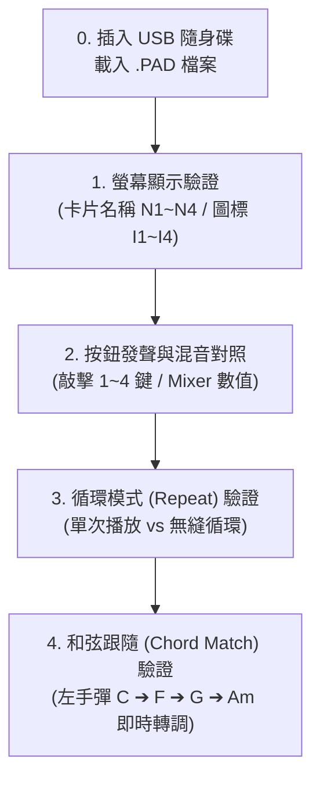

# Yamaha PSR-SX920 實體琴完整驗收查核手冊 (Phase 2.5 Checklist)

本手冊供您回家後對照 Yamaha PSR-SX920 實體琴，進行 **Phase 2.5 隨身碟載入與端對端功能驗收**。照著以下步驟逐一對照打勾，即可在 5~10 分鐘內完成全系統相容性驗證。

---

## 🛠️ 行前準備：匯出測試檔與隨身碟裝載

1. **隨身碟格式**：確認 USB 隨身碟為 `FAT32` 或 `exFAT` 格式（PSR-SX920 原生支援）。
2. **檔案取得**（二選一）：
   - **方式 A（網頁端一鍵匯出）**：開啟網頁編輯器 `http://localhost:5173`，載入樣品或匯入 MIDI 切片後，點擊右上角 **[匯出修改後的檔案]**（檔名如 `MyPad.PAD`）。
   - **方式 B（腳本批次產出）**：在終端機執行：
     ```bash
     npx.cmd tsx export-usb.ts
     ```
     腳本會自動將標準 4-Pad 樣品檔生成至 `usb_test_export/` 目錄中。
3. **拷貝檔案**：將產出的 `.PAD` 檔案拷貝至 USB 隨身碟根目錄或任意資料夾。
4. **插上實體琴**：將隨身碟插入 PSR-SX920 正面或右下方的 **[USB TO DEVICE]** 插槽。

---

## 📋 實機四階段完整驗證清單



---

### 第一階段：觸控螢幕 UI 顯示驗證（名稱 N1~N4 與圖標 I1~I4）

#### 🎯 目的：確認 PSR-SX920 系統核心已完整解析 Yamaha 專屬標記，介面顯示正常無亂碼。

1. **琴端載入操作**：
   - 按下琴面板上的 **[MULTI PAD SELECT]** 實體按鈕（或在 Home 觸控主螢幕點選 **[Multi Pad]** 區塊）。
   - 頁籤選擇 **「USB 1」**，找到您的 `.PAD` 檔案並點擊載入。
2. **觀察觸控螢幕卡片**：
   - 載入完成後，螢幕中央會呈現 4 個獨立的 Pad 方塊卡片。

| 檢查項目 | 觀察位置 | 預期正確結果 (Pass) | 異常現象 (Fail) | 驗收勾選 |
| :--- | :--- | :--- | :--- | :---: |
| **檔案載入相容性** | 琴端螢幕彈窗 | 順利載入，無任何警示視窗 | 出現「Data Error」或「Unrecognized File」 | [x] |
| **Pad 1 名稱與圖標** | 螢幕 Pad 1 方格 | 顯示您設定的名稱（如 `Piano Chords`）且圖標吻合 | 顯示空白、亂碼或預設值 `Pad 1` | [x] |
| **Pad 2 名稱與圖標** | 螢幕 Pad 2 方格 | 顯示自訂名稱（如 `Acoustic Gtr`）且圖標吻合 | 顯示空白、亂碼或預設值 `Pad 2` | [x] |
| **Pad 3 名稱與圖標** | 螢幕 Pad 3 方格 | 顯示自訂名稱（如 `Bass Groove`）且圖標吻合 | 顯示空白、亂碼或預設值 `Pad 3` | [x] |
| **Pad 4 名稱與圖標** | 螢幕 Pad 4 方格 | 顯示自訂名稱（如 `Drum Kit`）且圖標吻合 | 顯示空白、亂碼或預設值 `Pad 4` | [x] |

---

### 第二階段：物理按鍵發聲與混音參數驗證（Volume / Pan / Voice）

#### 🎯 目的：確認音符事件發聲正常，且二進位注入之 CC7（音量）與 CC10（聲相）精確反映在琴端混音台。

#### 步驟 2-A：[MULTI PAD CONTROL] 實體按鈕敲擊發聲
找到琴面板右側或控制區的 5 顆實體按鈕：**[1]、[2]、[3]、[4]、[STOP]**。

| 檢查項目 | 測試動作 | 預期正確結果 (Pass) | 驗收勾選 |
| :--- | :--- | :--- | :---: |
| **Pad 1 發聲** | 按下按鈕 **[1]** | 喇叭立即演奏 Pad 1 樂句，音質清晰無破音 | [x] |
| **Pad 2 發聲** | 按下按鈕 **[2]** | 喇叭立即演奏 Pad 2 樂句，音色正確無誤 | [x] |
| **Pad 3 發聲** | 按下按鈕 **[3]** | 喇叭立即演奏 Pad 3 樂句，低音或琶音清晰 | [x] |
| **Pad 4 發聲** | 按下按鈕 **[4]** | 喇叭立即演奏 Pad 4 樂句，節奏或打擊點同步 | [x] |
| **即時停止 (Panic)** | 音樂演奏中按下 **[STOP]** | 音樂瞬間停止，**喇叭無殘響掛音、無持續發聲怪音** | [x] |

#### 步驟 2-B：[MIXER] 混音台參數精確對照
按下琴面上的 **[MIXER]**（或 **[MIXING CONSOLE]**）實體鍵，在頂部頁籤切換至 **「Multi Pad」**。

| 檢查項目 | 琴端顯示欄位 | 對照標準 (Pass) | 驗收勾選 |
| :--- | :--- | :--- | :---: |
| **Volume (CC7)** | 各軌虛擬推桿高度與數值 (0~127) | 與網頁混音推桿設定一致（例如設定 90 即顯示 90） | [x] |
| **Pan (CC10)** | 各軌立體聲聲相旋鈕 (L64~C~R63) | 置中顯示 `C`；若設定偏左/右則顯示對應數值 | [x] |
| **Voice Name** | 各軌音色名稱文字 | 正確顯示原廠音色名稱（如 `ConcertGrand`、`AcousticBass`） | [x] |

---

### 第三階段：Repeat（循環模式）無縫播放驗證

#### 🎯 目的：驗證 RP 控制字串（`RP0000` / `RP1111`）在實機上的循環接續流暢度。

| 測試模式 | 操作方法 | 預期正確結果 (Pass) | 驗收勾選 |
| :--- | :--- | :--- | :---: |
| **單次播放模式 (Repeat OFF)** | 在網頁關閉該軌 Repeat 匯出；在琴上按 **[1]** | 樂句播完指定小節（如 2 小節）後**自動平穩結束**，按鍵燈熄滅 | [x] |
| **無縫循環模式 (Repeat ON)** | 在網頁開啟該軌 Repeat 匯出；在琴上按 **[1]** | 播到最後一小節結束瞬間，**零延遲立即跳回第 1 小節重播**，無雜音卡頓 | [x] |

---

### 第四階段：Chord Match（和弦跟隨 / CASM 轉調）驗證

#### 🎯 目的：驗證 SFF2 CASM 區塊（NTR: Root Trans / NTT: Chord Trans）即時音高演算相容性。

1. **開啟琴端伴奏模式**：確認琴上的 **[ACMP]**（伴奏）按鈕已點亮（琴鍵左手區為和弦偵測區）。
2. **觸發 Pad 播放**：按下有開啟 Chord Match 的 Pad 按鈕（如鋼琴或吉他琶音 Pad）。
3. **左手在鍵盤左側彈奏不同和弦**：

| 測試動作 (左手彈奏) | 預期正確結果 (Pass) | 驗收勾選 |
| :--- | :--- | :---: |
| **彈奏 C 大三和弦 (C Major)** | Pad 演奏標準 C 調音階/和弦（根音為 C） | [x] |
| **換彈 F 大三和弦 (F Major)** | Pad **即時轉為 F 調演奏**，聲部平滑過渡無爆音破音 | [x] |
| **換彈 G 或 G7 和弦** | Pad **即時轉為 G 調演奏**，和聲色彩與伴奏協調 | [x] |
| **換彈 Am 小三和弦 (A Minor)** | Pad **即時轉換為小調性質**（降第 3 音），聽感自然和諧 | [x] |
| **固定打擊樂測試 (Drums/Perc)** | 鼓組軌（CM 關閉）：左手不論彈任何和弦，**鼓點與打擊音高維持固定不變** | [x] |

---

## 🚨 實機問題速查與對策表 (Troubleshooting)

| 異常現象 | 可能原因 | 解決對策 |
| :--- | :--- | :--- |
| **琴端顯示「Data Error」** | SMF 頭部或 SFF2 CASM Chunk 結構偏移 | 檢查 `pad-synthesizer.ts` 的 `MThd` 與 `CASM` 頭部，重跑單元測試確認二進位長度。 |
| **有按鍵燈但無聲音** | 音量 CC7 被設為 0，或通道（Channel）與琴端 Multi Pad 接收聲部未對應 | 進入琴端 [MIXER] 頁面檢查推桿是否在底部；確認 Track 1~4 分別指派至 Ch 1~4。 |
| **換和弦時音高跳躍或出現怪音** | CASM NTT 轉調規則（Chord Transpose）與原 MIDI 基準調（Source Chord）不匹配 | 確認 MIDI 原始調性是否為 C 大調（Root C, Chord Maj），必要時在匯入精靈進行音高歸一化。 |
| **換音色後中段又跳回舊音色** | 軌道內部帶有中途的 Program Change 事件 | 已於 Commit `7292422` 修復，確保已使用最新版本代碼重新匯出檔案。 |

---

## 📝 驗證結果回報速填格式 (可直接複製回傳)

在 2026-10-16 完成 PSR-SX920 實機連線端對端驗收，結果如下：

```text
【PSR-SX920 實機驗收回報】
1. 螢幕顯示（名稱與圖標）：[x] 全部正常
2. 實體按鍵發聲：[x] 4 軌發聲正常
3. Mixer 數值（Volume/Pan/Chorus）：[x] 與網頁一致
4. Repeat 循環：[x] 無縫循環正常
5. Chord Match 轉調：[x] 和弦即時跟隨完美
結論：實機各階段功能端對端驗證 100% 通過！
```
