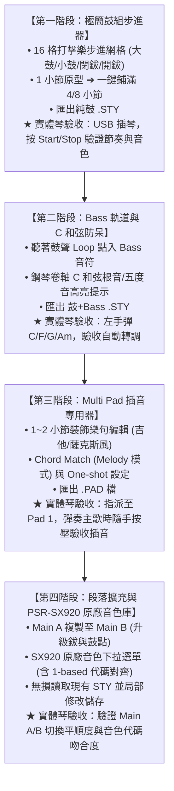

# Yamaha PSR-SX920 伴奏風格 (STY) 與插音 (PAD) 專注創作版 (V2) 執行計畫書

> **文件版本**：v2.0.0  
> **建立日期**：2026-10-22  
> **適用設備**：Yamaha PSR-SX920 工作站電子琴、家用電腦 (Home PC)、公司電腦 (Work PC)  
> **專案定位**：聚焦於「從零建立、直覺編輯與修改 STY & PAD」，徹底解決實體琴面板操作繁瑣痛點的極簡專注工具。

---

## 壹、專案背景與戰略轉向 (Strategic Pivot)

### 1.1 過去經驗總結
在 V1 的開發過程中，功能延伸到了「全曲 MIDI 分析、調性自動偵測、33 軌總覽分析、混音重組」，功能雖然龐大，但偏離了最初「需要一個好用、直覺的 STY 與 PAD 建立編輯工具」的初衷。同時因對琴端底層限制（如 Bank 代碼、和弦轉換規則、SFF 格式）的認知落差，導致實體驗收時衍生出非預期的困惑。

### 1.2 V2 核心宗旨
- **初衷回歸**：鎖定在 **STY（伴奏風格）** 與 **PAD（多功能打擊板插音）** 的建立、編輯與修改。
- **解決琴上痛點**：凡是在 PSR-SX920 觸控螢幕或轉盤上不好操作、費時費力的工作（如逐小節錄鼓、複製小節、修音、配和弦），全部移到電腦軟體上以滑鼠直覺完成。
- **嚴謹步進驗收**：每完成一個核心階段，即產出實體二進位檔案，於家中實體 PSR-SX920 上實機插隨身碟驗收，確認無誤才進入下一階段。

---

## 貳、核心痛點剖析與軟體解決方案

依據實際彈奏與製程討論，歸納出四大核心痛點與對應解法：

### 痛點 1：鼓組分層建立繁瑣，4/8 小節複製費力
* **琴上現況**：缺乏即時演奏多指鼓能力時，必須分次錄音（先錄 Hi-Hat，再錄大鼓、小鼓）。在琴上製作 4 小節或 8 小節時，因不熟悉複製選單，只能逐小節重複按琴鍵錄製，若有拍點不準還要在事件清單裡用轉盤逐筆修改。
* **V2 解決方案**：
  1. **16 格打擊樂步進網格（Drum Step Sequencer）**：一小節切為 16 等分（16 分音符），大鼓、小鼓、閉鈸、開鈸各佔一行，滑鼠點擊方格即發聲，拍點 100% 絕對精準，分層疊加絕不互相覆蓋。
  2. **1 小節原型 ➔ 一鍵鋪滿 4/8 小節（1-Click Clone）**：專心調好第 1 小節節奏原型，按一下按鈕瞬間自動複製延伸為 4 小節或 8 小節。
  3. **尾小節過門微調（Fill / Variation）**：直接在第 4 小節末尾點入小鼓連擊（Snare Roll）或在第 1 拍加入 Crash 碎音鈸，快速做出自然生動的伴奏段落。

---

### 痛點 2：和弦轉換規則混亂與走音問題
* **琴上現況**：琴友常疑惑「為什麼伴奏軌寫實際歌曲和弦會走音？」或「為什麼 Intro/Ending 必須按特定和弦才能聽？」。
* **底層機制解析**：
  - **STY 伴奏軌** 是「律動公式」，必須以 **C 和弦（C 大調 / C7）** 為基準製作。現場彈奏時，琴的 CASM 電腦會以左手按壓的和弦為目標進行全軌移調。若伴奏軌內直接寫入 C ➔ Am ➔ F ➔ G，現場左手又按和弦，兩者會產生「乘法疊加」，造成嚴重衝突與走音。
  - **Intro / Ending**：原廠伴奏的前奏往往預製了一整段完整故事，必須以指定的「第一級主和弦（通常為 C）」起跑，琴才能正確認識調性；若手滑按成小和弦（Am），琴會啟動小調降音演算法，將大調音階強制拉扁，導致聽感如恐怖片走音。
* **V2 解決方案**：
  1. **鋼琴卷軸 C 和弦防呆高亮**：在編輯 Bass 或伴奏樂器時，畫面上自動以明亮底色標記 C、E、G、B 音符，提示最佳和弦音位置。
  2. **轉換模式清楚切換**：
     - `跟隨左手和弦 (Chord Match)`：用於需要隨左手手動轉調的伴奏與樂器插音。
     - `固定原音播放 (Bypass)`：用於固定旋律、鼓過門或音效，不管左手按什麼鍵，琴都不會介入亂改音符。

---

### 痛點 3：Multi Pad 插音與移調表現差異
* **實例問題**：使用他人製作的 PAD，按琴上的 `Transpose (+/-)` 移調鍵旋律正常，但「左手手動換和弦指法」時旋律卻跑調變形。
* **原因剖析**：
  1. **琴端移調鍵 (Transpose)** 是硬體全域平移（Master Pitch Shift），不經過和弦轉換演算法。
  2. **左手手動換和弦** 會觸發琴內的 **NTT（音符轉換規則）**。若原作者誤設為 `Chord（和弦模式）`，琴會將非和弦音強制壓縮撕裂；必須設定為 **`Melody（旋律模式）`** 才能保留旋律線條起伏。
* **V2 解決方案**：
  - 在 V2 製作 PAD 插音時，後端自動指派為 `NTT = Melody` 規範，保證不管是按移調鍵或手動換指法彈奏，旋律均 100% 自然和諧。

---

### 痛點 4：音色跑掉、降級為 GM、與琴端代碼不符
* **實例問題**：以 Yamaha 官方軟體做好的 STY，經過二次儲存後，音色代碼對不上、部分樂器音色跑掉（如 MegaVoice 變雜音）。
* **原因剖析**：
  1. **1-based vs 0-based 代碼落差**：底層 MIDI Program Change 是 `0 ~ 127`，但 PSR-SX920 螢幕與說明書一律顯示為 `1 ~ 128`，直接看 MIDI 數值會覺得每一隻音色都差了 1 號。
  2. **Bank 0-0 降級漏洞**：早期通用表誤將未指定音色設為 General MIDI (`MSB: 0, LSB: 0`)，導致原本高階的 MegaVoice（Bank 8-32）或 Live! 音色（Bank 104-0）被降級，產生破音。
* **V2 解決方案**：
  1. **直接對齊 PSR-SX920 原廠 2,300+ 音色資料庫**，徹底移除 GM Bank 0-0 預設。
  2. **介面雙重標示**：例如顯示 `[PC 25 (琴端顯示: 26) - Finger Bass]`，完全消除對照疑惑。
  3. **無損繼承機制**：載入現有 STY/PAD 時，嚴格保留原檔的 MSB/LSB/PC，非使用者主動修改絕不覆蓋。

---

## 參、軟體工程隔離與架構規劃

為了讓開發乾淨、無負擔，同時完全保留過去驗證成功的底層資產，採取「核心共享、前台隔離」策略：

```text
d:\Vibe Coding\MIDI
├── src/
│   ├── core/                    <-- 【完全保留】共享 184 個通過測試的 Yamaha 底層引擎
│   │   ├── writer/              <-- SFF2 / CASM / MultiPad / 音色注入二進位核心
│   │   ├── data/yamaha-voices.ts <-- PSR-SX920 原廠 2,300+ 音色清單
│   │   └── parser/              <-- Yamaha 專屬檔案二進位解析器
│   │
│   ├── creator/                 <-- 【全新獨立目錄】專注創作版前端模組
│   │   ├── creator-app.ts       <-- 輕量主控邏輯 (無任何冗餘分析演算法)
│   │   ├── drum-step-grid.ts    <-- 16 格打擊樂步進網格元件
│   │   ├── piano-roll-lite.ts   <-- 簡潔 Bass / 和弦鋼琴卷軸 (含 C 和弦底色防呆)
│   │   └── voice-selector.ts    <-- SX920 原廠音色選擇器 (1-based/0-based 對齊)
│   │
│   └── ui/                      <-- 【舊版暫存】歷史龐大功能完整保留，不刪除不衝突
│
├── creator.html                 <-- 【全新極簡入口】專注創作工作台 (秒級載入)
└── index.html                   <-- 保留舊入口備查 (嚴格遵守規則：不修改 index-00 與 index-0902)
```

---

## 肆、四階段執行計畫與 PSR-SX920 驗收里程碑



### 第一階段詳細規格（立即執行）
1. **介面**：
   - 頂部導航：`[STY 節奏製作]` / `[PAD 插音製作]` 切換開關。
   - 播放控制：`[播放 / 暫停]`、`[BPM 設定 (預設 120)]`、`[小節長度 (1/4/8 小節)]`。
2. **鼓機步進器**：
   - 4 行打擊樂：`[大鼓 Kick C1]`、`[小鼓 Snare D1]`、`[閉鈸 Closed Hat F#1]`、`[碎音鈸 Crash C#1]`。
   - 點擊格子即時播放 Web Audio 合成鼓聲預聽。
   - 提供按鈕：`【一鍵鋪滿 4 小節】`、`【一鍵鋪滿 8 小節】`。
3. **匯出**：
   - 按鈕：`【匯出為 .STY】`。
   - 調用已驗證的 `style-synthesizer.ts`，自動寫入正確的 SInt 初始化小節、標準鼓組音色（Bank 127-0-0），生成相容 PSR-SX920 的合法 SFF2 二進位檔。

---

## 伍、雙電腦（公司 / 家中）同步與驗收操作指引

### 5.1 工作切換與 Git 同步步驟
* **公司電腦完成進度時**：
  ```powershell
  git status
  git add .
  git commit -m "feat(creator): 完成第一階段極簡鼓組步進器與匯出功能"
  git push origin main
  ```
* **回到家中電腦時**：
  ```powershell
  git pull origin main
  npm run dev
  ```
  打開瀏覽器瀏覽：`http://localhost:5173/creator.html`。

### 5.2 實體琴 PSR-SX920 驗收步驟
1. 在電腦瀏覽器點選 `【匯出為 .STY】`，將下載的檔案存入 USB 隨身碟。
2. 隨身碟插入 PSR-SX920 面板 USB 插槽。
3. 點擊螢幕上的 Style 選擇區域，切換至 `User` ➔ `USB1`。
4. 點選剛剛儲存的風格檔載入。
5. 按下面板 `[SYNC START]` 或 `[START/STOP]` 聆聽播放：
   - 檢查鼓組音色是否清晰（是否為標準鼓組，有無變成鋼琴或靜音）。
   - 檢查 4 小節循環是否順暢，尾小節過門是否自然。

---

## 陸、進度追蹤看板 (Progress Tracker)

| 任務模組 | 規劃內容 | 狀態 | 驗收方式 |
| :--- | :--- | :---: | :--- |
| **0. 架構籌備** | 建立 `index.html`、`src/creator/` 獨立架構 | ✓ 已完成 | 本地 Vite 正常啟動載入 |
| **1. 鼓組步進網格** | 16 格網格、點擊發聲、1 鍵鋪滿 4/8 小節 (徹底清空殘留音符) | ✓ 已完成 | 電腦端播放聽感正常 |
| **1.1 STY 鼓軌匯出** | 調用後端寫入 SFF2 二進位 STY | ✓ 已完成 | 通過單元測試，支援直接下載 |
| **1.2 鼓組選擇與琴端監聽** | 官方鼓組下拉選單 (Rock/Pop/Jazz 等) + USB 實體琴即時發聲 | ✓ 已完成 | Web MIDI 串接 PSR-SX920 Channel 10 |
| **2. Bass 鋼琴卷軸** | 伴奏音符繪製、C 和弦根音/五度音底色提示、Web Audio 貝斯合成器 | ✓ 已完成 | 聽鼓聲疊加 Bass 音符 |
| **2.1 STY Bass 匯出** | 寫入 Channel 11 Bass CASM 和弦轉換表 | ✓ 已完成 | PSR-SX920 左手彈 C/F/G 跟隨轉調 |
| **2.2 Chord 1 和弦卷軸** | 支援多音複音、流行鋼琴四拍/吉他刷弦範本、原廠和弦音色庫 | ✓ 已完成 | 電腦端與 Web MIDI Ch 12 即時試聽 |
| **2.3 STY Chord 1 匯出** | 寫入 Channel 12 Chord 1 CASM 和弦轉換表 | ✓ 已完成 | 通過 `creator-chord-export.test.ts` 驗證 |
| **3. Multi Pad 模式** | 1~2 小節短樂句、Pad 1(鼓)/2(Bass)/3(和弦)、Chord Match 旗標 | ✓ 基礎完成 | 匯出 .PAD 檔在琴端指派 Pad 驗收 |
| **4. 音色與多段落擴充** | Main A/B/C/D、Fill In AA~DD、Intro/Ending 切換與一鍵複製 | ✓ 已完成 | 實體琴面板切換 Main/Fill 平順播放 |
